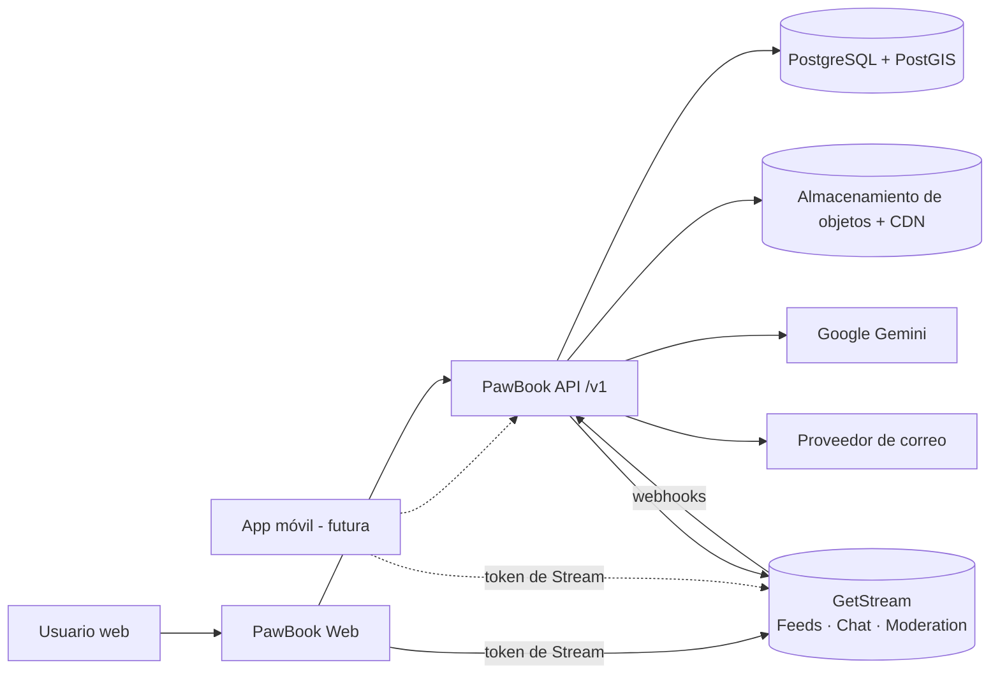
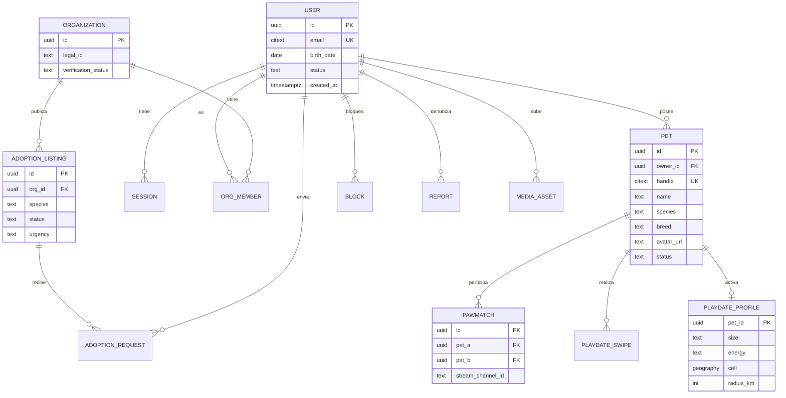
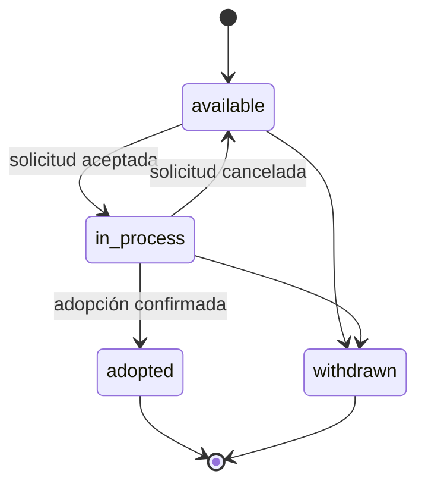
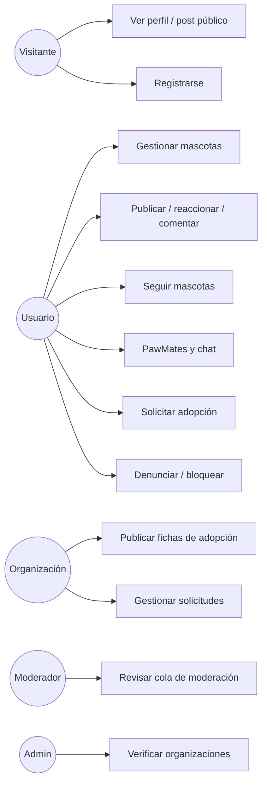

# Especificación de Requisitos de Software (SRS) — PawBook

Conforme a la estructura IEEE 830-1998.

| Campo | Valor |
|---|---|
| Producto | PawBook (plataforma web + API pública) |
| Versión | 1.1 — alcance MVP (Fase 1) |
| Fecha | 2026-11-13 |
| Estado | Borrador para aprobación |

### Historial de cambios

| Versión | Fecha | Autor | Cambio |
|---|---|---|---|
| 1.0 | 2026-11-12 | Equipo PawBook | Versión inicial a partir de la evaluación del demo y el PRD 1.0 |
| 1.1 | 2026-11-13 | Equipo PawBook | Alineación con el sistema de diseño de `docs/diseno/` (18 pantallas, tema claro y oscuro): UI-006..009, FR-PET-008, FR-SOC-005, FR-PM-008..009, FR-ADO-005, FR-MOD-006; ampliados FR-SOC-004, FR-PM-001 y FR-PM-006 |

### Convenciones

- **"deberá"** = obligatorio (*shall*); **"debería"** = deseable (*should*); **"podrá"** = opcional (*may*).
- Prioridad MoSCoW: **M** (Must), **S** (Should), **C** (Could), **W** (Won't en esta versión).
- Identificadores: `FR-<ÁREA>-NNN` funcionales, `NFR-<TIPO>-NNN` no funcionales, `CON-<TIPO>-NNN` restricciones.

---

## 1. Introducción

### 1.1 Propósito

Este documento especifica los requisitos funcionales y no funcionales de la versión MVP de PawBook. Está dirigido al equipo de desarrollo (backend, frontend, QA), a los socios del producto y a futuros equipos que construirán la aplicación móvil sobre la misma API.

### 1.2 Alcance

**PawBook** es una red social para perros y gatos compuesta por:

1. **PawBook API**: servicio backend en TypeScript sobre Node.js-compatible (runtime Bun) que expone una API REST versionada, agnóstica del cliente.
2. **PawBook Web**: aplicación web responsive que consume exclusivamente la PawBook API y los SDK cliente de GetStream.

El MVP cubre cuentas, perfiles de mascota, feed social, seguidores, notificaciones, búsqueda, PawMates (descubrimiento y chat), adopciones de organizaciones verificadas, moderación y el generador de pies de foto con IA. Quedan fuera: pagos, donaciones, mercadito, veterinarios, telemedicina y aplicación móvil (ver PRD §6).

**Objetivo:** alcanzar ≥ 40 % de activación y ≥ 20 % de retención D30 en la beta (PRD §4).

### 1.3 Definiciones, acrónimos y abreviaturas

| Término | Definición |
|---|---|
| Usuario | Persona humana titular de una cuenta. Responsable legal de su contenido. |
| Mascota | Perfil público de un perro o gato, propiedad de un Usuario. Es el autor visible del contenido. |
| Mascota activa | Mascota con la que el Usuario actúa en la sesión actual. |
| Organización | Refugio o fundación verificada por un administrador. |
| Publicación (post) | Actividad del feed con texto y hasta 10 imágenes. |
| Reacción | Interacción tipada sobre una publicación: `paw`, `heart`, `bone`, `fish`. |
| Match | Interés mutuo entre dos mascotas en PawMates. |
| GetStream / Stream | Proveedor SaaS de feeds de actividad, chat, video y moderación (getstream.io). |
| Feed | Colección ordenada de actividades en GetStream. |
| Token de Stream | JWT firmado por el backend con el secreto de Stream que autoriza al cliente a conectarse a Stream como un usuario. |
| BFF | *Backend for Frontend*. |
| MAU | Usuarios activos mensuales. |
| p95 | Percentil 95 de latencia. |
| PII | Información personal identificable. |
| OpenAPI | Especificación estándar para describir APIs REST (versión 3.1). |

### 1.4 Referencias

| Referencia | Descripción |
|---|---|
| IEEE Std 830-1998 | Prácticas recomendadas para SRS |
| PRD PawBook 1.0 | [01-PRD.md](01-PRD.md) |
| Evaluación del demo | [00-evaluacion-demo.md](00-evaluacion-demo.md) |
| Arquitectura PawBook 1.0 | [03-arquitectura.md](03-arquitectura.md) |
| OWASP ASVS 4.0.3 | Estándar de verificación de seguridad de aplicaciones |
| WCAG 2.2 | Pautas de accesibilidad web |
| Documentación de GetStream | Activity Feeds v3, Chat, Moderation (getstream.io/docs) |
| RGPD (UE 2016/679) / Ley 1581 de 2012 (Colombia) | Protección de datos; aplica según el mercado elegido (PRD Q1) |

### 1.5 Visión general del documento

La sección 2 describe el producto en su contexto. La sección 3 enumera los requisitos específicos verificables. Los apéndices contienen el glosario ampliado, modelos de análisis y la matriz de trazabilidad.

---

## 2. Descripción general

### 2.1 Perspectiva del producto

PawBook es un sistema nuevo. Sustituye al prototipo de Google AI Studio, que se conserva solo como referencia visual.

#### 2.1.1 Interfaces de sistema
- GetStream (Feeds, Chat, Moderation) mediante SDK de servidor y webhooks.
- Google Gemini mediante SDK de servidor.
- Proveedor de identidad Google (OAuth 2.0 / OIDC).
- Proveedor de correo transaccional.
- Almacenamiento de objetos compatible con S3 y CDN.

#### 2.1.2 Interfaces de usuario
Aplicación web responsive (360 px a 1.920 px), instalable como PWA, con tema claro y oscuro. La referencia visual es el sistema de diseño de [`docs/diseno/`](diseno/index.html) (pantallas móvil, desktop, onboarding y catálogo de estados), que sustituye al demo de Google AI Studio.

#### 2.1.3 Interfaces de hardware
Cámara y galería del dispositivo para subir imágenes; geolocalización del navegador para PawMates (con permiso explícito).

#### 2.1.4 Interfaces de software
Navegadores soportados: las dos últimas versiones estables de Chrome, Edge, Firefox y Safari (incluido Safari iOS).

#### 2.1.5 Interfaces de comunicaciones
HTTPS (TLS 1.2+) para la API; WebSocket seguro (WSS) para los SDK de GetStream.

#### 2.1.6 Restricciones de memoria
Sin restricciones especiales en el cliente más allá de un *bundle* inicial ≤ 250 KB comprimido (NFR-PERF-005).

#### 2.1.7 Operaciones
Modos: normal, mantenimiento (solo lectura) y degradado (si GetStream no está disponible, la API sigue sirviendo perfiles, adopciones y búsqueda).

#### 2.1.8 Adaptación al sitio
Despliegue en contenedores en tres entornos: `development`, `staging`, `production`, cada uno con su propia app de GetStream.

### 2.2 Funciones del producto

| Área | Funciones |
|---|---|
| Cuentas | Registro, verificación de correo, login con correo y Google, recuperación de contraseña, sesiones, eliminación de cuenta |
| Mascotas | Crear, editar, archivar, seleccionar mascota activa, `@handle` único |
| Feed | Publicar, editar, eliminar, reaccionar, comentar, guardar, compartir por URL |
| Social | Seguir/dejar de seguir mascotas, feed "Siguiendo", feed "Para ti" |
| Notificaciones | Centro de notificaciones en tiempo real |
| Búsqueda | Mascotas por nombre, `@handle`, raza; hashtags |
| PawMates | Perfil de juego, descubrimiento por cercanía, interés, match, chat 1:1 |
| Adopciones | Verificación de organizaciones, fichas de adopción, solicitudes |
| IA | Generación de pies de foto |
| Moderación | Denuncias, bloqueo, moderación automática, panel interno |

### 2.3 Características de los usuarios

| Clase | Características | Conocimiento técnico |
|---|---|---|
| Visitante | Llega por un enlace compartido o un buscador. | Bajo |
| Usuario (dueño) | 18-45 años (según PRD Q2), usa redes sociales a diario, principalmente desde el móvil. | Bajo-medio |
| Organización | Personal o voluntarios de refugios, uso intermitente desde ordenador. | Bajo |
| Moderador | Personal interno formado en las políticas de comunidad. | Medio |
| Administrador | Personal técnico u operativo. | Alto |

Se considerarán usuarios con lector de pantalla, baja visión y navegación por teclado (NFR-USA-001).

### 2.4 Restricciones

| ID | Restricción |
|---|---|
| CON-TECH-001 | El backend y el frontend deberán escribirse en TypeScript (modo `strict`). |
| CON-TECH-002 | El gestor de paquetes y *runtime* de desarrollo deberá ser Bun. El código de servidor deberá ejecutarse también en Node.js 22 LTS (sin APIs exclusivas de Bun en el dominio). |
| CON-TECH-003 | GetStream deberá ser el proveedor de feeds de actividad, chat y moderación. |
| CON-TECH-004 | El backend deberá ser agnóstico del cliente: toda capacidad expuesta a la web deberá estar disponible por la API pública `/v1` para la futura app móvil. |
| CON-TECH-005 | Los secretos de GetStream, Gemini y la base de datos nunca deberán llegar al cliente. |
| CON-REG-001 | El tratamiento de datos personales deberá cumplir la normativa del mercado elegido (RGPD o Ley 1581). |
| CON-REG-002 | El contenido generado por IA deberá identificarse como tal. |
| CON-REG-003 | Ninguna funcionalidad del MVP deberá procesar pagos. |

### 2.5 Supuestos y dependencias

| ID | Supuesto o dependencia |
|---|---|
| AS-01 | GetStream ofrece feeds v3, chat y moderación con SDK de servidor para Node.js y SDK de cliente para React y React Native. Se confirmará en el spike técnico (PRD §11). |
| AS-02 | El volumen inicial es ≤ 10.000 MAU y ≤ 50.000 publicaciones al mes. |
| AS-03 | El mercado inicial es un único país e idioma (español). |
| AS-04 | Gemini mantiene salida estructurada JSON con esquema. |
| AS-05 | Cambiar de proveedor de feeds o de IA no deberá requerir cambios en clientes (ver ADR-003 de arquitectura). |

---

## 3. Requisitos específicos

### 3.1 Requisitos de interfaces externas

#### 3.1.1 Interfaces de usuario

| ID | Requisito | Prioridad |
|---|---|---|
| UI-001 | Cada recurso público (perfil de mascota, publicación, ficha de adopción, hashtag) deberá tener una URL estable y compartible. | M |
| UI-002 | El layout deberá ser de 3 columnas en ≥ 1.280 px, 2 columnas en ≥ 1.024 px y 1 columna con barra de navegación inferior en < 1.024 px. | M |
| UI-003 | La interfaz deberá mostrar en todo momento la mascota activa y permitir cambiarla en ≤ 2 interacciones. | M |
| UI-004 | Los estados vacíos, de carga y de error deberán estar diseñados para cada vista. | M |
| UI-005 | Las páginas públicas deberán incluir metadatos Open Graph y Twitter Card. | S |
| UI-006 | La interfaz deberá ofrecer tema claro y oscuro. Por defecto seguirá `prefers-color-scheme`; el usuario podrá fijarlo manualmente y la preferencia se recordará en el dispositivo. El tema deberá aplicarse antes del primer pintado (sin parpadeo) y ambos temas deberán cumplir el contraste de WCAG 2.2 AA. | M |
| UI-007 | La web deberá ser instalable como PWA: manifiesto, iconos, `service worker` con la carcasa de la aplicación en caché y una página sin conexión. Las notificaciones push quedan para la Fase 2. | S |
| UI-008 | En ≥ 1.280 px, el feed deberá mostrar una columna lateral con: PawMates cerca (o una invitación a activarlo si la mascota activa no lo tiene), fichas de adopción destacadas de la ciudad (urgentes primero) y sugerencias de mascotas a seguir. En < 1.280 px estos bloques no se muestran. | S |
| UI-009 | La web deberá publicar una página de ayuda (preguntas frecuentes y contacto) enlazada desde el pie de página y desde los ajustes. | S |

#### 3.1.2 Interfaces de hardware
| ID | Requisito | Prioridad |
|---|---|---|
| HW-001 | La subida de imágenes deberá aceptar la cámara del dispositivo y la galería. | M |
| HW-002 | La geolocalización deberá solicitarse solo al activar PawMates y con explicación previa. | M |

#### 3.1.3 Interfaces de software

| ID | Requisito | Prioridad |
|---|---|---|
| SW-001 | La API deberá publicar su contrato en OpenAPI 3.1 en `/v1/openapi.json`, generado desde el código. | M |
| SW-002 | La API deberá integrarse con GetStream mediante el SDK oficial de servidor. | M |
| SW-003 | La API deberá recibir webhooks de GetStream y verificar su firma antes de procesarlos. | M |
| SW-004 | La API deberá acceder a Gemini únicamente a través de un puerto `AiProvider` interno, de modo que el modelo y el proveedor sean configurables. | M |
| SW-005 | Las imágenes deberán subirse directamente del cliente al almacenamiento de objetos mediante URLs prefirmadas emitidas por la API. | M |

#### 3.1.4 Interfaces de comunicaciones

| ID | Requisito | Prioridad |
|---|---|---|
| COM-001 | Toda comunicación deberá usar HTTPS/WSS con TLS ≥ 1.2. | M |
| COM-002 | La API deberá autenticar mediante cabecera `Authorization: Bearer <access_token>`. La web podrá usar además cookie `HttpOnly; Secure; SameSite=Lax`. | M |
| COM-003 | Los errores deberán responder con el formato RFC 9457 (`application/problem+json`). | M |
| COM-004 | Las colecciones deberán paginarse por cursor (`?cursor=&limit=`, límite máximo 50). | M |

### 3.2 Requisitos funcionales

#### 3.2.1 Autenticación y cuenta (AUTH)

| ID | Requisito | Entradas → Salidas / Errores | Prioridad |
|---|---|---|---|
| FR-AUTH-001 | El sistema deberá permitir el registro con correo, contraseña y fecha de nacimiento. | Correo, contraseña (≥ 10 caracteres, verificada contra listas de contraseñas filtradas), fecha → cuenta en estado `pending_verification`. Error 409 si el correo existe; 422 si la edad es menor a la mínima. | M |
| FR-AUTH-002 | El sistema deberá enviar un enlace de verificación de correo válido por 24 h. | → Cuenta `active`. Enlace caducado: 410 y opción de reenvío. | M |
| FR-AUTH-003 | El sistema deberá permitir iniciar sesión con Google (OIDC). | Token de Google → sesión. Si el correo ya existe, se vincula tras verificar propiedad. | M |
| FR-AUTH-004 | El sistema deberá emitir un *access token* de vida corta (≤ 15 min) y un *refresh token* rotatorio (≤ 30 días). | Reutilizar un *refresh token* revocado deberá invalidar toda la familia de tokens. | M |
| FR-AUTH-005 | El sistema deberá permitir la recuperación de contraseña por correo. | Enlace de un solo uso válido 1 h. La respuesta no deberá revelar si el correo existe. | M |
| FR-AUTH-006 | El sistema deberá impedir publicar, comentar o chatear a cuentas sin correo verificado. | 403 `email_not_verified`. | M |
| FR-AUTH-007 | El sistema deberá permitir listar y cerrar sesiones activas. | | S |
| FR-AUTH-008 | El sistema deberá permitir eliminar la cuenta. Deberá borrar o anonimizar los datos en PostgreSQL, almacenamiento de objetos y GetStream en ≤ 30 días. | Confirmación con contraseña o reautenticación. | M |
| FR-AUTH-009 | El sistema deberá permitir exportar los datos personales en JSON. | | S |
| FR-AUTH-010 | El sistema deberá emitir, para el usuario autenticado, un token de Stream de vida ≤ 24 h mediante `POST /v1/stream/token`. | | M |

#### 3.2.2 Mascotas (PET)

| ID | Requisito | Prioridad |
|---|---|---|
| FR-PET-001 | El sistema deberá permitir a un Usuario crear hasta 10 mascotas con: nombre (1-40 caracteres), especie (`dog`, `cat`), raza (catálogo + texto libre), fecha de nacimiento aproximada, sexo, avatar, portada opcional, bio (≤ 300 caracteres), juguete y premio favoritos opcionales. | M |
| FR-PET-002 | El sistema deberá asignar a cada mascota un `@handle` único global (3-30 caracteres, `[a-z0-9_.]`), editable como máximo una vez cada 30 días. | M |
| FR-PET-003 | El sistema deberá mostrar el perfil público de la mascota con publicaciones, seguidores y seguidos. | M |
| FR-PET-004 | El sistema deberá permitir editar los datos de la mascota solo a su Usuario propietario. | M |
| FR-PET-005 | El sistema deberá registrar todas las acciones sociales (publicar, reaccionar, comentar, seguir, chatear) en nombre de la mascota activa, validando en servidor que pertenece al Usuario autenticado. | M |
| FR-PET-006 | El sistema deberá permitir archivar una mascota; su perfil y contenido dejarán de ser visibles para terceros. | S |
| FR-PET-007 | El sistema podrá permitir que una mascota tenga co-propietarios. | W (pendiente PRD Q5) |
| FR-PET-008 | El perfil de la mascota deberá mostrar el nombre de pila del Usuario responsable ("Responsable: Laura"). El Usuario podrá ocultarlo desde los ajustes; nunca se mostrarán apellidos, correo ni otros datos de contacto. | S |

#### 3.2.3 Feed y publicaciones (FEED)

| ID | Requisito | Prioridad |
|---|---|---|
| FR-FEED-001 | El sistema deberá permitir crear una publicación con texto (≤ 2.200 caracteres) y entre 0 y 10 imágenes; al menos uno de los dos deberá existir. | M |
| FR-FEED-002 | El sistema deberá aceptar imágenes JPEG, PNG, WebP y HEIC de hasta 15 MB, eliminar metadatos EXIF (incluida la ubicación GPS) y generar variantes de 320, 640 y 1.080 px en WebP/AVIF. | M |
| FR-FEED-003 | El sistema deberá permitir añadir a la publicación un estado de ánimo (catálogo del demo) y una ubicación textual opcional. | S |
| FR-FEED-004 | El sistema deberá distribuir la publicación al feed de la mascota autora y al feed "Siguiendo" de sus seguidores. | M |
| FR-FEED-005 | El sistema deberá permitir al autor editar el texto (se marca como editado) y eliminar la publicación, retirándola de todos los feeds. | M |
| FR-FEED-006 | El sistema deberá permitir una reacción por mascota y publicación, de tipo `paw`, `heart`, `bone` o `fish`. Una nueva reacción reemplaza la anterior; repetir la misma la retira. Los contadores deberán actualizarse en tiempo real para los clientes conectados. | M |
| FR-FEED-007 | El sistema deberá permitir comentar (≤ 500 caracteres) y responder con un nivel de anidamiento, y eliminar los propios comentarios. El autor de la publicación podrá eliminar comentarios de su publicación. | M |
| FR-FEED-008 | El sistema deberá permitir guardar publicaciones en una colección privada. | S |
| FR-FEED-009 | El sistema deberá extraer hashtags (`#palabra`) y menciones (`@handle`) del texto; las menciones generan notificación. | S |
| FR-FEED-010 | El sistema deberá servir las publicaciones y perfiles públicos a visitantes sin sesión, en modo solo lectura. | S |

#### 3.2.4 Relaciones sociales (SOC)

| ID | Requisito | Prioridad |
|---|---|---|
| FR-SOC-001 | El sistema deberá permitir a la mascota activa seguir y dejar de seguir a otras mascotas. | M |
| FR-SOC-002 | El sistema deberá ofrecer el feed "Siguiendo" en orden cronológico inverso. | M |
| FR-SOC-003 | El sistema deberá ofrecer el feed "Para ti" con publicaciones de las últimas 72 h ordenadas por interacción, excluyendo mascotas bloqueadas. | M |
| FR-SOC-004 | El sistema deberá sugerir mascotas y Organizaciones a seguir, por especie y ciudad, excluyendo las ya seguidas y las bloqueadas. Las sugerencias se mostrarán en el onboarding (con la meta de seguir 5 y la opción de omitir el paso) y en la columna lateral del feed (UI-008). | S |
| FR-SOC-005 | El sistema deberá permitir a la mascota activa seguir y dejar de seguir Organizaciones verificadas. Las publicaciones y las fichas nuevas de la Organización aparecerán en el feed "Siguiendo" de sus seguidores. | S |

#### 3.2.5 Notificaciones (NOT)

| ID | Requisito | Prioridad |
|---|---|---|
| FR-NOT-001 | El sistema deberá notificar al Usuario cuando una de sus mascotas reciba reacción, comentario, mención, nuevo seguidor o match. | M |
| FR-NOT-002 | El sistema deberá agrupar notificaciones del mismo tipo sobre el mismo objeto (por ejemplo, "Luna y 12 más reaccionaron"). | S |
| FR-NOT-003 | El sistema deberá mostrar el número de notificaciones no leídas en tiempo real y permitir marcarlas como leídas. | M |
| FR-NOT-004 | El sistema deberá permitir configurar qué notificaciones se envían por correo. | C |

#### 3.2.6 Búsqueda (SRCH)

| ID | Requisito | Prioridad |
|---|---|---|
| FR-SRCH-001 | El sistema deberá buscar mascotas por nombre, `@handle` y raza, con tolerancia a tildes y errores tipográficos. | M |
| FR-SRCH-002 | El sistema deberá ofrecer una página por hashtag con sus publicaciones recientes. | C |

#### 3.2.7 PawMates (PM)

| ID | Requisito | Prioridad |
|---|---|---|
| FR-PM-001 | El sistema deberá permitir activar PawMates por mascota con: tamaño (`small`, `medium`, `large`), energía (`calm`, `moderate`, `hyper`), actividad favorita, temperamento opcional (sociable con perros, con gatos, con niños) y radio de búsqueda (1-25 km). | M |
| FR-PM-002 | El sistema deberá almacenar la ubicación reducida a una celda de ~1 km y nunca deberá exponer coordenadas exactas a otros usuarios. | M |
| FR-PM-003 | El sistema deberá listar candidatos dentro del radio, de la misma especie o compatibles, ordenados por distancia aproximada y compatibilidad, excluyendo bloqueados y ya evaluados. | M |
| FR-PM-004 | El sistema deberá registrar "me interesa" o "paso" por candidato. Cuando el interés sea mutuo deberá crear un match y notificar a ambos. | M |
| FR-PM-005 | El sistema deberá crear un canal de chat 1:1 en GetStream Chat al producirse el match. Solo los Usuarios propietarios de las mascotas del match deberán ser miembros. | M |
| FR-PM-006 | El chat deberá soportar texto, imágenes, indicador de escritura, estado de entrega y lectura, presencia ("en línea") y moderación automática. | M |
| FR-PM-007 | El sistema deberá permitir deshacer un match, lo que archiva el canal para ambos. | S |
| FR-PM-008 | El sistema deberá permitir desactivar PawMates en cualquier momento. Al desactivarlo, la mascota deja de aparecer como candidata y se borra la ubicación almacenada; los matches y canales existentes se conservan. | M |
| FR-PM-009 | Cada candidato deberá mostrar una etiqueta de compatibilidad calculada en servidor (`high` "Muy compatible", `medium` "Compatible") a partir de tamaño, energía y temperamento, y la distancia redondeada al kilómetro ("≈ 2 km"). | S |

#### 3.2.8 Organizaciones (ORG)

| ID | Requisito | Prioridad |
|---|---|---|
| FR-ORG-001 | El sistema deberá permitir a un Usuario solicitar la creación de una Organización aportando nombre, identificación legal, ciudad, contacto y documento acreditativo. | M |
| FR-ORG-002 | El sistema deberá permitir a un administrador aprobar o rechazar la solicitud con motivo. Solo las Organizaciones aprobadas mostrarán la insignia "Verificada". | M |
| FR-ORG-003 | El sistema deberá permitir a una Organización invitar a otros Usuarios como gestores. | S |

#### 3.2.9 Adopciones (ADO)

| ID | Requisito | Prioridad |
|---|---|---|
| FR-ADO-001 | El sistema deberá permitir a gestores de una Organización verificada publicar fichas de adopción: nombre, especie, raza, edad, sexo, ciudad, fotos, estado de salud (vacunado, esterilizado, desparasitado), descripción y urgencia (`normal`, `urgent`, `foster`). | M |
| FR-ADO-002 | La ficha deberá tener estados `available` → `in_process` → `adopted` o `withdrawn`. | M |
| FR-ADO-003 | El sistema deberá permitir filtrar fichas por especie, ciudad, edad y urgencia. | M |
| FR-ADO-004 | El sistema deberá permitir a un Usuario verificado enviar una solicitud de adopción con un cuestionario; la solicitud deberá abrir un canal de chat con la Organización y enviar un correo a sus gestores. | M |
| FR-ADO-005 | Al publicar una ficha, o al marcarla como urgente, el sistema deberá publicar una actividad "Nuevo en adopción" en el feed de la Organización, enlazada a la ficha, para que llegue al feed "Siguiendo" de sus seguidores. Cuando la ficha pase a `adopted` o `withdrawn`, la actividad deberá mostrar el estado final. | S |

#### 3.2.10 Inteligencia artificial (AI)

| ID | Requisito | Prioridad |
|---|---|---|
| FR-AI-001 | El sistema deberá generar 3 sugerencias de pie de foto a partir de la mascota activa, el estado de ánimo y una descripción opcional. | S |
| FR-AI-002 | El sistema deberá limitar el uso de IA a 20 solicitudes por usuario y día, y responder 429 con cabecera `Retry-After` al superarlo. | M |
| FR-AI-003 | El sistema deberá tratar la entrada del usuario como dato, delimitarla en el prompt, validar la salida contra un esquema y filtrarla con la moderación antes de devolverla. | M |

#### 3.2.11 Moderación y seguridad de la comunidad (MOD)

| ID | Requisito | Prioridad |
|---|---|---|
| FR-MOD-001 | El sistema deberá permitir denunciar publicaciones, comentarios, mensajes, mascotas y Organizaciones con un motivo de un catálogo. | M |
| FR-MOD-002 | El sistema deberá ofrecer a los moderadores una cola de revisión con denuncias y contenido marcado automáticamente, priorizada por gravedad. | M |
| FR-MOD-003 | El sistema deberá permitir a un Usuario bloquear a otro; ambos dejarán de ver el contenido del otro y no podrán interactuar ni chatear. | M |
| FR-MOD-004 | El sistema deberá permitir a los moderadores ocultar o eliminar contenido y advertir, suspender temporalmente o expulsar cuentas, registrando cada acción en un log de auditoría inmutable. | M |
| FR-MOD-005 | El sistema deberá analizar texto e imágenes antes de publicarlos (GetStream Moderation) y bloquear o enviar a revisión según la política configurada. | M |
| FR-MOD-006 | Cuando la moderación automática bloquee un contenido, el autor deberá poder pedir una revisión humana, una vez por contenido. El texto de la publicación se conserva; la solicitud entra en la cola de FR-MOD-002 y el resultado se notifica al autor. | S |

### 3.3 Requisitos de rendimiento

| ID | Requisito | Prioridad |
|---|---|---|
| NFR-PERF-001 | El p95 de latencia de la API deberá ser ≤ 300 ms y el p99 ≤ 800 ms con 200 solicitudes por segundo, excluyendo los endpoints de IA. | M |
| NFR-PERF-002 | Una publicación deberá aparecer en el feed de un seguidor conectado en ≤ 5 s desde su confirmación. | M |
| NFR-PERF-003 | Los mensajes de chat deberán entregarse en ≤ 1 s (p95) entre clientes conectados. | M |
| NFR-PERF-004 | El *Largest Contentful Paint* del feed deberá ser ≤ 2,5 s en un móvil de gama media con 4G. | M |
| NFR-PERF-005 | El JavaScript inicial deberá ser ≤ 250 KB comprimido. | S |
| NFR-PERF-006 | Los endpoints de IA deberán responder en ≤ 8 s (p95) o devolver un error controlado. | S |
| NFR-PERF-007 | El sistema deberá soportar 10.000 MAU y 1.000 usuarios concurrentes sin degradación (AS-02). | M |

### 3.4 Restricciones de diseño

| ID | Restricción | Prioridad |
|---|---|---|
| CON-DES-001 | El backend deberá estructurarse como monolito modular con arquitectura hexagonal por módulo (ver arquitectura §4). | M |
| CON-DES-002 | Los proveedores externos (GetStream, Gemini, almacenamiento, correo) deberán quedar detrás de puertos; el dominio no deberá importar sus SDK. | M |
| CON-DES-003 | Los contratos de la API deberán definirse una sola vez (esquemas Zod) en el repositorio de la API y publicarse como paquete versionado con semver y como `openapi.json`; los clientes deberán consumir esas versiones publicadas. | M |
| CON-DES-006 | Cada aplicación (API, web, móvil) deberá vivir en un repositorio independiente con CI y despliegue propios. | M |
| CON-DES-004 | La API deberá versionarse por ruta (`/v1`). Los cambios incompatibles deberán publicarse como `/v2` y mantener `/v1` al menos 6 meses. | M |
| CON-DES-005 | PostgreSQL deberá ser la fuente de verdad de identidad, mascotas, organizaciones, adopciones y matches; GetStream será la fuente de verdad de actividades, reacciones, comentarios y mensajes. | M |

### 3.5 Atributos del sistema

#### 3.5.1 Fiabilidad
| ID | Requisito | Prioridad |
|---|---|---|
| NFR-REL-001 | Las operaciones que escriben en PostgreSQL y GetStream deberán ser idempotentes (cabecera `Idempotency-Key`) y reintentarse mediante cola con *backoff* exponencial ante fallos del proveedor. | M |
| NFR-REL-002 | Las llamadas a proveedores externos deberán tener *timeout* (≤ 5 s, IA ≤ 15 s) y *circuit breaker*. | M |
| NFR-REL-003 | El RPO deberá ser ≤ 15 min y el RTO ≤ 4 h para PostgreSQL. | M |

#### 3.5.2 Disponibilidad
| ID | Requisito | Prioridad |
|---|---|---|
| NFR-AVA-001 | La API deberá tener disponibilidad mensual ≥ 99,5 %. | M |
| NFR-AVA-002 | Si GetStream no está disponible, perfiles, adopciones y búsqueda deberán seguir funcionando y la web deberá mostrar un aviso de degradación. | S |

#### 3.5.3 Seguridad
| ID | Requisito | Prioridad |
|---|---|---|
| NFR-SEC-001 | El sistema deberá cumplir OWASP ASVS 4.0.3 nivel 2. | M |
| NFR-SEC-002 | Las contraseñas deberán almacenarse con Argon2id. | M |
| NFR-SEC-003 | Toda entrada deberá validarse con esquema en el borde de la API; las respuestas de error no deberán exponer detalles internos. | M |
| NFR-SEC-004 | La API deberá aplicar *rate limiting* por IP y por usuario (por defecto 120 solicitudes/min; autenticación 10/min; IA según FR-AI-002). | M |
| NFR-SEC-005 | La autorización deberá verificarse por recurso en servidor (propiedad de mascota, membresía de organización, rol). | M |
| NFR-SEC-006 | Los tokens de Stream deberán emitirse solo para el usuario autenticado y con expiración; los permisos de escritura en Stream desde el cliente deberán limitarse con las políticas de permisos de la app de Stream. | M |
| NFR-SEC-007 | Los secretos deberán gestionarse con un gestor de secretos y rotarse al menos cada 12 meses. | M |
| NFR-SEC-008 | La web deberá enviar cabeceras CSP, HSTS, `X-Content-Type-Options` y `Referrer-Policy`. | M |

#### 3.5.4 Mantenibilidad
| ID | Requisito | Prioridad |
|---|---|---|
| NFR-MAINT-001 | La cobertura de tests de dominio y casos de uso deberá ser ≥ 80 %. | M |
| NFR-MAINT-002 | Ningún módulo deberá importar el interior de otro; la comunicación entre módulos deberá pasar por su API pública o eventos de dominio, verificado en CI. | M |
| NFR-MAINT-003 | Cada pull request deberá pasar formato, lint, tipos, tests y build en CI. | M |
| NFR-MAINT-004 | Las decisiones de arquitectura deberán registrarse como ADR. | S |

#### 3.5.5 Portabilidad
| ID | Requisito | Prioridad |
|---|---|---|
| NFR-PORT-001 | La API deberá empaquetarse como imagen OCI ejecutable en cualquier proveedor de contenedores. | M |
| NFR-PORT-002 | Un cliente móvil deberá poder implementarse usando solo la especificación OpenAPI y los SDK móviles de GetStream, sin cambios en el backend. | M |

#### 3.5.6 Usabilidad y accesibilidad
| ID | Requisito | Prioridad |
|---|---|---|
| NFR-USA-001 | La web deberá cumplir WCAG 2.2 nivel AA. | M |
| NFR-USA-002 | Un usuario nuevo deberá poder registrarse, crear su mascota y publicar en ≤ 3 minutos (medido en pruebas con 5 usuarios). | S |

#### 3.5.7 Observabilidad
| ID | Requisito | Prioridad |
|---|---|---|
| NFR-OBS-001 | Toda solicitud deberá llevar un `request_id` propagado a logs estructurados (JSON) y trazas OpenTelemetry. | M |
| NFR-OBS-002 | Los logs no deberán contener PII ni secretos. | M |
| NFR-OBS-003 | Deberá haber alertas por tasa de errores 5xx > 1 %, p95 > 500 ms y fallos de webhooks. | M |

### 3.6 Otros requisitos

| ID | Requisito | Prioridad |
|---|---|---|
| OR-DB-001 | El esquema de base de datos deberá gestionarse con migraciones versionadas y reversibles. | M |
| OR-DB-002 | Las tablas deberán usar identificadores UUIDv7 y marcas de tiempo `timestamptz` en UTC. | M |
| OR-I18N-001 | Todos los textos de la interfaz deberán externalizarse en catálogos de traducción; el MVP se publica en español. | S |
| OR-I18N-002 | Las fechas y números deberán formatearse según la configuración regional del usuario. | S |
| OR-LEG-001 | La web deberá publicar términos de servicio, política de privacidad, política de cookies y normas de comunidad, y registrar su aceptación con versión y fecha. | M |

---

## 4. Apéndices

### A. Glosario
Ver §1.3. Términos adicionales: *fan-out* (distribución de una actividad a los feeds de los seguidores), *webhook* (llamada HTTP de GetStream hacia la API ante un evento), *outbox* (patrón de publicación fiable de eventos desde la base de datos).

### B. Modelos de análisis

#### B.1 Modelo entidad-relación (PostgreSQL)

Publicaciones, reacciones, comentarios, seguidores, notificaciones y mensajes viven en GetStream (CON-DES-005).

#### B.2 Estados de una ficha de adopción

#### B.3 Casos de uso principales

### C. Matriz de trazabilidad

| Objetivo de negocio (PRD §4) | Historias (PRD §7) | Requisitos | Verificación |
|---|---|---|---|
| Activación ≥ 40 % | US-01, US-02, US-10, US-15 | FR-AUTH-001..003, FR-PET-001..002, FR-FEED-001..004, FR-AI-001, NFR-USA-002 | E2E "registro → mascota → publicación"; prueba de usabilidad |
| Retención D30 ≥ 20 % | US-11, US-12, US-13, US-20 | FR-FEED-006..007, FR-SOC-001..003, FR-NOT-001..003 | Tests de integración con Stream; analítica de cohortes |
| Red: ≥ 5 seguidos | US-13, US-19, US-21 | FR-SOC-001, FR-SOC-004..005, FR-SRCH-001, UI-008 | Analítica de onboarding |
| PawMates: ≥ 3 mensajes por match | US-30..US-34 | FR-PM-001..009, FR-MOD-003, NFR-PERF-003 | E2E con dos usuarios; prueba de privacidad de ubicación |
| Solicitudes de adopción | US-40..US-43 | FR-ORG-001..002, FR-ADO-001..005, UI-008 | E2E organización → ficha → solicitud; ficha visible en el feed de seguidores |
| Contenido resuelto < 24 h | US-50..US-53 | FR-MOD-001..006 | Tests de cola de moderación; SLA en panel |
| Experiencia fiel al diseño | US-06, US-18 | UI-002..004, UI-006..009, FR-PET-008, NFR-USA-001 | Revisión visual contra `docs/diseno/` en tema claro y oscuro; auditoría WCAG en ambos temas |
| Cliente móvil sin cambios de backend | — | CON-TECH-004, SW-001, NFR-PORT-002 | Generar cliente desde OpenAPI y ejecutar *contract tests* |
| Cumplimiento legal | US-05 | FR-AUTH-008..009, CON-REG-001..003, OR-LEG-001 | Revisión legal; test de borrado en Stream |

### D. Lista de verificación de este documento

- [x] Secciones IEEE 830 completas
- [x] Requisitos con identificador único y prioridad
- [x] Requisitos verificables (con umbral medible donde aplica)
- [x] Matriz de trazabilidad
- [ ] Preguntas abiertas del PRD §13 resueltas (Q1, Q2 y Q5 afectan a FR-AUTH-001, FR-PET-007 y CON-REG-001)
- [ ] Aprobación de los socios
