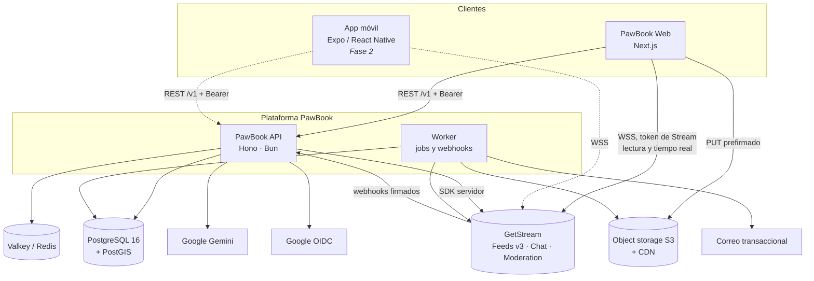
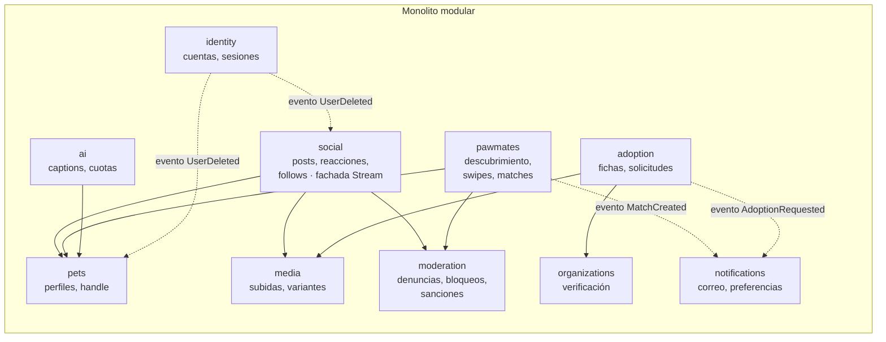
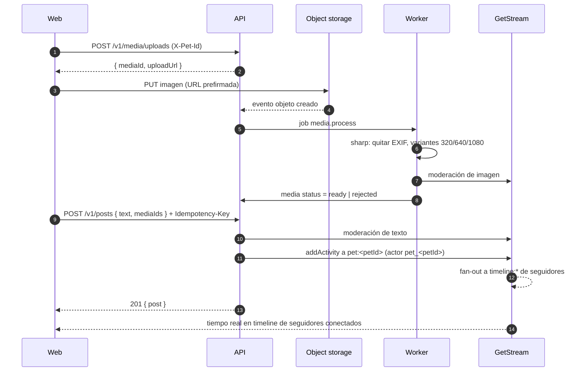
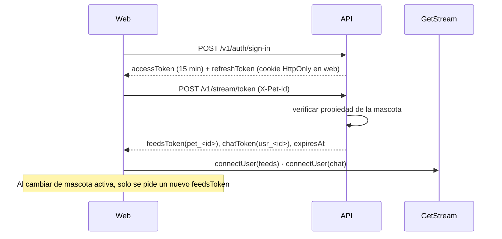
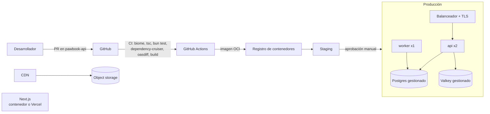

# Arquitectura — PawBook

| Campo | Valor |
|---|---|
| Versión | 1.1 |
| Fecha | 2026-11-13 |
| Alcance | MVP web + backend agnóstico preparado para app móvil |
| Stack obligatorio | TypeScript · Node.js-compatible · Bun (gestor de paquetes y runtime) · GetStream |
| Requisitos | [02-SRS.md](02-SRS.md) |
| Diagrama interactivo | [arquitectura.html](arquitectura.html) |

---

## 1. Principios

1. **API primero, cliente después.** La web es un cliente más de `/v1`. Si la app móvil no puede hacer algo con la API pública, la web tampoco (CON-TECH-004).
2. **Monolito modular, no microservicios.** Un equipo pequeño y 10 k MAU no justifican sistemas distribuidos. Los módulos tienen fronteras estrictas, así que cualquiera se puede extraer después si hace falta.
3. **Hexagonal por módulo.** El dominio no conoce Hono, Drizzle, GetStream ni Gemini; solo puertos (interfaces). Los adaptadores se enchufan en el borde.
4. **Contrato único.** Los esquemas Zod del paquete `@pawbook/contracts` (publicado desde `pawbook-api`) generan la validación del servidor, el OpenAPI y el cliente tipado. Nada se define dos veces.
5. **Comprar lo que no diferencia.** Feeds, chat, tiempo real y moderación se compran a GetStream. Lo que diferencia a PawBook (mascotas, PawMates, adopciones, IA) se construye.
6. **Decisiones reversibles baratas, irreversibles con ADR.**

## 2. Vista de contexto (C4 nivel 1)



### 2.1 Responsabilidad de cada pieza

| Pieza | Es fuente de verdad de | No hace |
|---|---|---|
| PostgreSQL | Usuarios, sesiones, mascotas, organizaciones, adopciones, perfiles PawMates, swipes, matches, bloqueos, denuncias, medios, outbox | Feeds ni mensajes |
| GetStream Feeds | Publicaciones (actividades), reacciones, comentarios, seguidores, notificaciones, guardados | Identidad ni permisos de negocio |
| GetStream Chat | Canales y mensajes de PawMates y adopción | Decidir quién puede chatear (lo decide la API al crear el canal) |
| GetStream Moderation | Clasificación automática de texto e imágenes | Sanciones de cuenta (las aplica la API) |
| Valkey/Redis | Rate limiting, caché caliente | Nada persistente |
| Object storage | Imágenes originales y variantes | |

## 3. Integración con GetStream

### 3.1 ADR-002: identidad en Stream

**Problema.** El humano es quien se autentica y responde legalmente, pero la mascota es quien publica, reacciona y es seguida. Si un humano con dos mascotas fuera un solo usuario de Stream, solo podría reaccionar una vez por publicación y los seguidores serían del humano, no de la mascota.

**Decisión.**

| Producto Stream | ID de usuario Stream | Motivo |
|---|---|---|
| **Feeds** | `pet_<petId>` | La mascota es el actor: reacciones únicas por mascota, seguidores por mascota. La API emite el token **para la mascota activa** después de verificar que pertenece al usuario. |
| **Chat** | `usr_<userId>` | La conversación es entre personas responsables (seguridad, bloqueos, moderación). El canal guarda en `custom` qué mascotas originaron el match. |

**Consecuencias.**
- Cambiar de mascota activa en la web reconecta el cliente de Feeds con un token nuevo (≈ 200 ms). El chat no se reconecta.
- El MAU facturado por Stream Feeds cuenta mascotas, no humanos (media estimada 1,3 mascotas por usuario). **Validar precio en el spike.**
- Alternativa descartada: usuario Stream = humano con `pet_id` en datos propios. Impide reacciones y seguidores por mascota sin lógica adicional.

### 3.2 Grupos de feed

| Grupo | ID | Contenido | Quién escribe |
|---|---|---|---|
| `pet` | `pet:<petId>` | Publicaciones de la mascota (su perfil) | Solo la API |
| `org` | `org:<orgId>` | Publicaciones y fichas "Nuevo en adopción" de una organización verificada (FR-ADO-005) | Solo la API |
| `timeline` | `timeline:<petId>` | Feed "Siguiendo" de la mascota; sigue a feeds `pet:*` y `org:*` (FR-SOC-005) | Fan-out de Stream |
| `notification` | `notification:<petId>` | Reacciones, comentarios, menciones, seguidores, matches (agregados) | Stream + API |
| `foryou` | `foryou:global` | Feed "Para ti" (popularidad reciente) | Job de ranking o selector de Stream, según el spike |

La web suscribe en tiempo real `timeline` y `notification` de la mascota activa, y los `notification` del resto de mascotas del usuario (máximo 10) para el contador global.

### 3.3 Quién escribe dónde

| Operación | Ruta | Motivo |
|---|---|---|
| Crear, editar y eliminar publicación | Cliente → **API** → Stream | Validación, moderación previa, medios procesados, hashtags, idempotencia |
| Reaccionar, comentar, seguir, guardar | Cliente → **API** → Stream | Reglas de negocio (bloqueos, mascota activa) y mismo comportamiento para web y móvil |
| Leer feeds y recibir tiempo real | Cliente → **Stream** directo con token | Latencia mínima y sin carga en la API |
| Enviar mensajes de chat | Cliente → **Stream Chat** directo | Patrón estándar de Stream; moderación configurada en la app de Stream; auditoría por webhook |
| Crear canales de chat | **API** (al hacer match o solicitar adopción) | Solo la API decide quién puede hablar con quién |

En la configuración de permisos de la app de Stream, los clientes tienen **solo lectura** sobre Feeds y lectura/escritura de mensajes en canales donde son miembros.

### 3.4 Puerto `SocialGraph` (ADR-003: aislar al proveedor)

El dominio no importa `@stream-io/*`. Habla con puertos:

```ts
// pawbook-api: src/modules/social/application/ports.ts
export interface SocialFeedPort {
  publish(post: NewPost): Promise<PostRef>;
  remove(postId: PostId, author: PetId): Promise<void>;
  react(postId: PostId, by: PetId, kind: ReactionKind): Promise<ReactionResult>;
  comment(postId: PostId, by: PetId, text: string, parentId?: CommentId): Promise<CommentRef>;
  follow(follower: PetId, target: PetId): Promise<void>;
  unfollow(follower: PetId, target: PetId): Promise<void>;
}

export interface ChatPort {
  openDirectChannel(a: UserId, b: UserId, meta: ChannelMeta): Promise<ChannelId>;
  archiveChannel(id: ChannelId): Promise<void>;
}

export interface RealtimeTokenPort {
  feedsToken(pet: PetId, ttlSeconds: number): string;
  chatToken(user: UserId, ttlSeconds: number): string;
}
```

`StreamSocialFeedAdapter`, `StreamChatAdapter` y `StreamTokenAdapter` los implementan con `@stream-io/node-sdk`. Los tests de casos de uso usan adaptadores en memoria. Si mañana hay que salir de Stream, se cambia el adaptador y los SDK de lectura del cliente; los contratos `/v1` no cambian.

### 3.5 Webhooks

`POST /v1/webhooks/stream` verifica la firma, guarda el evento en `inbox_events` (deduplicación por ID) y responde 200 en < 100 ms. El worker procesa:

| Evento | Acción |
|---|---|
| Moderación: contenido marcado | Crear ítem en la cola de moderación |
| `message.new` en canal de adopción | Correo a gestores de la organización |
| Reacción o comentario nuevo | Métricas; en la Fase 2, progreso de retos |
| Usuario eliminado | Confirmar borrado en el proceso de eliminación de cuenta |

## 4. Backend: estructura interna

### 4.1 Tecnologías

| Necesidad | Elección | Por qué | Alternativa |
|---|---|---|---|
| Runtime / paquetes | **Bun** (dev, tests, gestor); imagen de producción en Bun, compatible con Node 22 | Requisito; arranque y tests rápidos | Node 22 si aparece incompatibilidad |
| Framework HTTP | **Hono** + `@hono/zod-openapi` | Estándares web, funciona igual en Bun y Node, OpenAPI generado desde Zod | Fastify |
| Validación / contratos | **Zod** | Un esquema para validar, tipar y documentar | Valibot |
| ORM / migraciones | **Drizzle ORM** + drizzle-kit | SQL explícito, tipado, sin motor binario, buen soporte de PostGIS | Kysely |
| Base de datos | **PostgreSQL 16 + PostGIS + pg_trgm + unaccent** | Relacional, geoconsultas para PawMates, búsqueda difusa sin servicio extra | — |
| Autenticación | **Better Auth** (correo, Google, sesiones, plugin bearer/JWT) | TypeScript nativo, adaptador Drizzle, sirve a web (cookie) y móvil (bearer) | Lucia-style propio, Auth0 |
| Jobs y outbox | **pg-boss** (cola sobre PostgreSQL) | Sin infraestructura extra en el MVP; transaccional con el outbox | BullMQ + Redis al crecer |
| Rate limit / caché | **Valkey** (compatible Redis) | Contadores atómicos compartidos entre réplicas | — |
| Imágenes | **sharp** en el worker | Variantes WebP/AVIF, borrado de EXIF | Servicio de imágenes del CDN |
| IA | `@google/genai` detrás de `AiProvider` | Reutiliza los prompts del demo; modelo configurable | Otro proveedor por adaptador |
| Logs / trazas | **pino** + **OpenTelemetry** + Sentry | JSON estructurado y trazas distribuidas | — |
| Tests | `bun test` (unidad e integración) + Testcontainers (Postgres) | | Vitest |
| Lint / formato | **Biome** | Un solo binario, rápido | ESLint + Prettier |

### 4.2 Módulos (bounded contexts)



Reglas (verificadas en CI con `dependency-cruiser`, NFR-MAINT-002):
- Un módulo solo importa el `index.ts` público de otro módulo.
- Las dependencias van hacia dentro: `http → application → domain`; `infrastructure` implementa puertos de `application`.
- Los efectos entre módulos que no necesitan respuesta inmediata viajan como **eventos de dominio** por el outbox.

### 4.3 Estructura de un módulo

```
modules/pawmates/
├── domain/
│   ├── playdate-profile.ts      # entidad + invariantes (radio 1-25 km, celda ~1 km)
│   ├── match.ts                 # agregado Match
│   ├── compatibility.ts         # función pura de puntuación
│   └── events.ts                # MatchCreated, MatchUndone
├── application/
│   ├── ports.ts                 # PlaydateRepository, ChatPort, Clock
│   ├── discover-candidates.ts   # caso de uso
│   ├── swipe.ts                 # caso de uso: crea Match si es mutuo
│   └── undo-match.ts
├── infrastructure/
│   ├── drizzle-playdate-repository.ts
│   └── schema.ts                # tablas Drizzle del módulo
├── http/
│   └── routes.ts                # rutas Hono + esquemas de contracts
└── index.ts                     # API pública del módulo
```

### 4.4 Flujo de una solicitud

```
Hono route ─▶ middleware (requestId, auth, rateLimit, activePet)
           ─▶ validación Zod (contracts)
           ─▶ caso de uso (application)  ─▶ dominio (reglas puras)
                                          ─▶ puertos ─▶ adaptadores (Drizzle, Stream, Gemini)
           ─▶ respuesta tipada | problem+json
```

La mascota activa viaja en la cabecera `X-Pet-Id`. El middleware `activePet` verifica la propiedad en cada solicitud (caché de 60 s en Valkey) y la deja en el contexto. Así web y móvil funcionan igual y no hay estado de servidor ligado a la sesión.

### 4.5 Superficie de la API `/v1` (MVP)

| Recurso | Endpoints |
|---|---|
| Auth | `POST /auth/sign-up` · `POST /auth/sign-in` · `POST /auth/google` · `POST /auth/refresh` · `POST /auth/sign-out` · `POST /auth/verify-email` · `POST /auth/password/forgot` · `POST /auth/password/reset` |
| Cuenta | `GET /me` · `PATCH /me` · `GET /me/sessions` · `DELETE /me/sessions/{id}` · `POST /me/export` · `DELETE /me` |
| Tokens Stream | `POST /stream/token` → `{ feedsToken, chatToken, apiKey, expiresAt }` |
| Mascotas | `GET /me/pets` · `POST /pets` · `GET /pets/{handle}` · `PATCH /pets/{id}` · `POST /pets/{id}/archive` |
| Medios | `POST /media/uploads` → URL prefirmada · `GET /media/{id}` (estado) |
| Publicaciones | `POST /posts` · `PATCH /posts/{id}` · `DELETE /posts/{id}` · `GET /posts/{id}` (pública) |
| Interacciones | `PUT /posts/{id}/reaction` · `DELETE /posts/{id}/reaction` · `POST /posts/{id}/comments` · `DELETE /comments/{id}` · `PUT /posts/{id}/save` · `DELETE /posts/{id}/save` |
| Social | `PUT /pets/{id}/follow` · `DELETE /pets/{id}/follow` · `PUT /organizations/{id}/follow` · `DELETE /organizations/{id}/follow` · `GET /pets/{id}/followers` · `GET /pets/{id}/following` · `GET /suggestions/pets` · `GET /suggestions/organizations` |
| Búsqueda | `GET /search/pets?q=` · `GET /hashtags/{tag}` |
| PawMates | `PUT /pets/{id}/playdate-profile` · `DELETE /pets/{id}/playdate-profile` · `GET /pawmates/candidates` · `POST /pawmates/swipes` · `GET /pawmates/matches` · `DELETE /pawmates/matches/{id}` |
| Organizaciones | `POST /organizations` · `GET /organizations/{id}` · `POST /organizations/{id}/members` |
| Adopciones | `GET /adoptions` · `POST /adoptions` · `GET /adoptions/{id}` · `PATCH /adoptions/{id}` · `POST /adoptions/{id}/requests` |
| IA | `POST /ai/captions` |
| Moderación | `POST /reports` · `POST /moderation/appeals` · `PUT /blocks/{userId}` · `DELETE /blocks/{userId}` |
| Admin | `GET /admin/moderation/queue` · `POST /admin/moderation/actions` · `POST /admin/organizations/{id}/verify` |
| Sistema | `GET /health` · `GET /ready` · `GET /openapi.json` · `POST /webhooks/stream` |

Convenciones: JSON `camelCase`, fechas ISO-8601 UTC, IDs UUIDv7, paginación por cursor, `Idempotency-Key` en `POST` de creación, errores RFC 9457.

## 5. Flujos clave

### 5.1 Publicar una foto



### 5.2 Match en PawMates y apertura de chat

```mermaid
sequenceDiagram
  autonumber
  participant W as Web (Andrés)
  participant A as API
  participant DB as PostgreSQL
  participant ST as Stream Chat
  participant F as Stream Feeds
  W->>A: POST /v1/pawmates/swipes { target, like }
  A->>DB: INSERT swipe; ¿existe like inverso?
  alt interés mutuo
    A->>DB: INSERT match + outbox(MatchCreated) en una transacción
    A-->>W: 201 { matched: true, matchId }
    Note over A: Worker lee el outbox
    A->>ST: crear canal messaging (usr_A, usr_B, custom: petA, petB)
    A->>DB: guardar stream_channel_id
    A->>F: notificación en notification:petA y notification:petB
  else sin reciprocidad
    A-->>W: 201 { matched: false }
  end
```

### 5.3 Sesión y conexión en tiempo real



## 6. Frontend web

### 6.1 Tecnologías

| Necesidad | Elección | Por qué |
|---|---|---|
| Framework | **Next.js (App Router)** sobre Bun | SSR para perfiles y publicaciones públicas indexables (UI-001, UI-005, FR-FEED-010); el resto como app cliente |
| Datos del servidor | **TanStack Query** + cliente tipado de `@pawbook/contracts` (`openapi-fetch`) | Caché, reintentos, *optimistic updates* para reacciones |
| Tiempo real | SDK React de GetStream Feeds + `stream-chat-react` | Componentes de chat listos y personalizables con el tema PawBook |
| Estado de UI | **Zustand** (mascota activa, preferencias) | El demo mostró el coste del estado global en un componente |
| Formularios | React Hook Form + resolvers de Zod (esquemas de `@pawbook/contracts`) | Mismas validaciones que el servidor |
| Estilos | **Tailwind CSS 4** + tokens del demo en `src/design-system/` de `pawbook-web` | Conserva la identidad visual |
| Animación | `motion` (ya usado en el demo) | |
| i18n | `next-intl` | OR-I18N-001 |
| Tests | `bun test` + Testing Library; **Playwright** para E2E | |

**Regla:** Next.js no contiene lógica de negocio ni accede a la base de datos. Sus *route handlers* solo hacen de BFF fino para la cookie de *refresh token*. Todo lo demás llama a `/v1`, igual que hará la app móvil.

### 6.2 Rutas

| Ruta | Render | Contenido |
|---|---|---|
| `/` | Cliente | Feed "Siguiendo" / "Para ti" |
| `/@[handle]` | SSR | Perfil público de la mascota |
| `/p/[postId]` | SSR | Publicación pública |
| `/pawmates` · `/pawmates/matches` | Cliente | Descubrimiento y matches |
| `/mensajes` · `/mensajes/[channelId]` | Cliente | Chat |
| `/adopcion` · `/adopcion/[id]` | SSR | Fichas de adopción |
| `/notificaciones` · `/buscar` · `/guardados` | Cliente | |
| `/ajustes/*` · `/org/[id]/*` · `/admin/*` | Cliente | Cuenta, organización, moderación |

### 6.3 Organización del código web (por funcionalidad)

```
pawbook-web/src/
├── app/                 # rutas Next.js (delgadas: componen features)
├── features/
│   ├── feed/            # components/, hooks/ (useTimeline, useReact), api.ts
│   ├── pets/
│   ├── pawmates/
│   ├── chat/
│   ├── adoption/
│   ├── notifications/
│   └── auth/
├── design-system/       # tokens y componentes base portados del demo
├── lib/                 # api-client, stream-clients, query-client
└── stores/              # zustand: active-pet
```

Se portan del demo, divididos en componentes de ≤ 250 líneas: `PostCard`, `CreatePostModal`, `Navbar`, `NavigationTabs`, tarjetas de adopción y de candidatos de PawMates.

## 7. Repositorios (ADR-001: un repositorio por aplicación)

Cada aplicación vive en su propio repositorio, con su CI, su versionado y su despliegue. El único acoplamiento entre ellos es el **contrato de la API**, publicado como artefacto versionado.

| Repositorio | Contenido | Publica | Despliega |
|---|---|---|---|
| `pawbook-api` | API Hono, worker, dominio, migraciones, infraestructura local | Paquete `@pawbook/contracts` + `openapi.json` | Imagen OCI `api` / `worker` |
| `pawbook-web` | Next.js, sistema de diseño | — | Web |
| `pawbook-mobile` (Fase 2) | App móvil | — | Tiendas |
| `pawbook-docs` | PRD, SRS, arquitectura, ADR | — | — |

### 7.1 `pawbook-api`

```
pawbook-api/
├── src/
│   ├── modules/             # identity, pets, social, media, pawmates, organizations,
│   │                        # adoption, moderation, ai, notifications (estructura §4.3)
│   ├── shared/              # kernel compartido: ids, errores, eventos, outbox
│   ├── http/                # app Hono, middlewares, montaje de rutas por módulo
│   ├── composition/         # wiring de puertos → adaptadores por entorno
│   ├── main.api.ts          # entrypoint HTTP
│   └── main.worker.ts       # entrypoint worker (pg-boss, webhooks)
├── contracts/               # paquete publicable @pawbook/contracts
│   ├── src/                 # esquemas Zod por recurso + tipos inferidos
│   ├── openapi.json         # generado en build desde las rutas
│   └── package.json
├── migrations/              # drizzle-kit
├── test/                    # integración con Testcontainers
├── docker/                  # Dockerfile, docker-compose (Postgres+PostGIS, Valkey, MinIO)
├── biome.json
├── tsconfig.json
└── package.json
```

`contracts/` es una carpeta dentro del repo de la API, no un repo aparte: el contrato cambia junto con el código que lo implementa y se revisa en el mismo PR. Se declara como *workspace* de Bun **solo dentro de este repo** para que la API lo importe localmente.

Las fronteras entre módulos se verifican en CI con `dependency-cruiser` (§4.2): el dominio (`modules/*/domain`, `modules/*/application`) no puede importar `hono`, `drizzle-orm`, `@stream-io/*` ni `@google/genai`.

### 7.2 Cómo se comparte el contrato

```mermaid
flowchart LR
  subgraph API[pawbook-api]
    Z[Esquemas Zod] --> R[Rutas Hono]
    R --> O[openapi.json]
    Z --> P[@pawbook/contracts]
    O --> P
  end
  P -- release semver --> REG[(GitHub Packages<br/>registro npm privado)]
  O -- asset del release --> REL[GitHub Release]
  REG --> WEB[pawbook-web<br/>bun add @pawbook/contracts]
  REG --> MOBTS[pawbook-mobile si es Expo]
  REL --> MOBX[pawbook-mobile si es Flutter/nativo<br/>cliente generado desde OpenAPI]
```

- `@pawbook/contracts` exporta los esquemas Zod (validación de formularios en la web), los tipos TypeScript y un cliente tipado basado en `openapi-fetch`.
- Se publica con **semver** al crear un tag en `pawbook-api`:
  - *patch*: correcciones sin cambio de contrato;
  - *minor*: campos o endpoints nuevos (compatibles);
  - *major*: cambio incompatible, que exige una ruta `/v2` (CON-DES-004).
- El CI de `pawbook-api` compara el `openapi.json` del PR con el de `main` (`oasdiff breaking`) y **falla** si hay un cambio incompatible en `/v1`.
- La web fija una versión (`"@pawbook/contracts": "^1.4.0"`) y la actualiza con Renovate o Dependabot.
- Configuración del registro en los repos consumidores:

```toml
# bunfig.toml
[install.scopes]
pawbook = { url = "https://npm.pkg.github.com", token = "$NPM_TOKEN" }
```

### 7.3 Desarrollo local entre repos

| Situación | Cómo |
|---|---|
| Trabajar solo en la web | Apuntar `NEXT_PUBLIC_API_URL` a staging, o levantar la API con `docker compose up` desde `pawbook-api` |
| Cambio de contrato + web a la vez | `bun link` de `pawbook-api/contracts` en `pawbook-web`; publicar versión de `contracts` antes de mergear el PR de la web |
| Probar una rama de la API desde la web | Publicar versión *prerelease* (`1.5.0-next.3`) desde la rama |

### 7.4 Consecuencias

- **A favor:** despliegues y permisos independientes (se puede dar acceso solo a `pawbook-mobile` a un tercero); la app móvil puede usar cualquier tecnología; historial y CI más simples por repo.
- **En contra:** un cambio que toca API y web son dos PR coordinados; hay que mantener la configuración de herramientas (TypeScript, Biome) en cada repo. Se mitiga con una plantilla de repo y con el chequeo de compatibilidad del contrato.

## 8. Datos

- **PostgreSQL** con un esquema por módulo (`identity`, `pets`, `pawmates`, `adoption`, `moderation`, `media`, `platform`), lo que hace visibles las fronteras y facilita una futura extracción.
- `pawmates.playdate_profiles.cell` es `geography(Point)` redondeado a ~1 km; los candidatos se buscan con `ST_DWithin` e índice GIST (FR-PM-002, FR-PM-003).
- Búsqueda de mascotas: índice GIN `pg_trgm` sobre `unaccent(name || ' ' || handle || ' ' || breed)` (FR-SRCH-001).
- **Outbox** (`platform.outbox`) escrito en la misma transacción que el cambio de dominio; el worker lo publica con pg-boss. Garantiza que un match nunca se pierde aunque Stream falle (NFR-REL-001).
- **Inbox** (`platform.inbox_events`) para deduplicar webhooks.
- Copias de seguridad: PITR del proveedor gestionado (RPO ≤ 15 min, NFR-REL-003).

## 9. Seguridad

| Amenaza | Control |
|---|---|
| Robo de token | Access token de 15 min; refresh rotatorio con detección de reutilización; cookie `HttpOnly` en web |
| Suplantar otra mascota | Middleware `activePet` valida propiedad en cada solicitud; tokens de Stream emitidos por mascota |
| Abuso de IA y costes | Autenticación obligatoria, cuota diaria por usuario en Valkey, `maxOutputTokens`, *circuit breaker* |
| *Prompt injection* | Entrada delimitada como dato, instrucciones de sistema separadas, salida validada con Zod y moderada |
| Escritura directa en Stream desde el cliente | Permisos de la app Stream: Feeds solo lectura para usuarios |
| Fuga de ubicación | Celdas de ~1 km; distancias redondeadas ("a menos de 2 km"); EXIF eliminado |
| Webhooks falsos | Verificación de firma HMAC + deduplicación |
| Subida de archivos maliciosos | URLs prefirmadas con tipo y tamaño fijados; reprocesado con sharp; nunca se sirve el original |
| Enumeración de cuentas | Respuestas uniformes en registro y recuperación |
| Secretos | Variables de entorno desde gestor de secretos; nunca en el bundle web (CON-TECH-005) |

## 10. Despliegue



- Una sola imagen OCI para `api` y `worker` con distinto *entrypoint* (NFR-PORT-001).
- Tres entornos con tres apps de GetStream separadas (`pawbook-dev`, `pawbook-staging`, `pawbook-prod`).
- Proveedor de nube intercambiable: cualquier plataforma con contenedores, Postgres gestionado con PostGIS, Redis/Valkey gestionado y almacenamiento S3 (por ejemplo OVHcloud, AWS, GCP, Fly.io + Neon + Cloudflare R2). La elección depende del mercado (PRD Q1) por residencia de datos.
- Desarrollo local: `docker compose up` (Postgres + PostGIS, Valkey, MinIO) y `bun dev`.

## 11. Preparación para la app móvil (Fase 2)

| Necesidad móvil | Ya resuelto por |
|---|---|
| Autenticación sin cookies | Bearer token + refresh en almacenamiento seguro del dispositivo |
| Contrato de API | `openapi.json` (asset de cada release) o `@pawbook/contracts` si la app es Expo |
| Validaciones idénticas | `@pawbook/contracts` en Expo (Zod funciona en React Native); con Flutter o nativo, validaciones generadas desde OpenAPI |
| Feeds y chat | SDK de Stream para React Native con los mismos tokens |
| Push | Añadir `POST /v1/devices` y adaptador de push (Stream Chat soporta push vía FCM/APNs) |
| Subida de imágenes | Mismas URLs prefirmadas |
| Inicio de sesión con Apple | Proveedor adicional en Better Auth (obligatorio en App Store si hay Google) |

## 12. Registro de decisiones (ADR)

| ADR | Decisión | Estado |
|---|---|---|
| ADR-001 | Monolito modular con hexagonal por módulo; un repositorio por aplicación; contrato compartido como paquete versionado (§7) | Aceptada (sin monorepo) |
| ADR-002 | Identidad en Stream: Feeds = mascota, Chat = humano (§3.1) | Propuesta, validar coste en spike |
| ADR-003 | Proveedores detrás de puertos; el dominio no importa SDK externos | Propuesta |
| ADR-004 | Escrituras de feed por la API, lecturas y tiempo real directo a Stream (§3.3) | Propuesta |
| ADR-005 | Hono + Zod OpenAPI como capa HTTP; OpenAPI como contrato público | Propuesta |
| ADR-006 | PostgreSQL + PostGIS como fuente de verdad; pg-boss para jobs en el MVP | Propuesta |
| ADR-007 | Next.js como cliente puro de la API, sin lógica de negocio | Propuesta |
| ADR-008 | Better Auth con sesiones por cookie (web) y bearer (móvil) | Propuesta |
| ADR-009 | Reescritura en lugar de evolucionar el demo de AI Studio | Propuesta (ver evaluación) |

Cada ADR se desarrollará en `docs/adr/NNN-titulo.md` con contexto, decisión, alternativas y consecuencias.

## 13. Spike técnico previo (1 semana)

Antes de empezar M0 conviene confirmar los puntos con más incertidumbre:

1. Crear una app de GetStream y probar con `@stream-io/node-sdk` los grupos de feed de §3.2, reacciones únicas por usuario y notificaciones agregadas.
2. Medir el coste mensual estimado para 10 k usuarios / 13 k mascotas (ADR-002).
3. Probar GetStream Moderation con texto en español y fotos de mascotas (falsos positivos).
4. Confirmar cómo implementar "Para ti" (selectores o ranking de Stream vs. job propio).
5. Arrancar Hono + Drizzle + Better Auth en Bun y verificar el mismo build en Node 22.

## 14. Plan de construcción

Resumen por hitos. El plan detallado con tareas marcables está en [04-plan-construccion.md](04-plan-construccion.md).

| Hito | Semanas | Entregables técnicos |
|---|---|---|
| Spike | 1 | Respuestas a §13, ADR-002 confirmado |
| M0 Fundaciones | 2 | Repos `pawbook-api` y `pawbook-web`, registro privado de paquetes, CI, Docker local, `identity`, `pets`, `/stream/token`, shell de la web con el sistema visual del demo |
| M1 Núcleo social | 3 | `media`, `social` (posts, reacciones, comentarios, follows), notificaciones, búsqueda |
| M2 PawMates y adopción | 3 | `pawmates`, chat, `organizations`, `adoption` |
| M3 Confianza | 2 | `moderation`, panel admin, borrado y exportación de cuenta, endurecimiento de seguridad, `ai` (captions) |
| Beta cerrada | 4 | Observabilidad, ajustes de rendimiento, corrección de errores |

Estimación orientativa para 2 desarrolladores full-stack: ~11 semanas hasta beta cerrada, más el spike.
