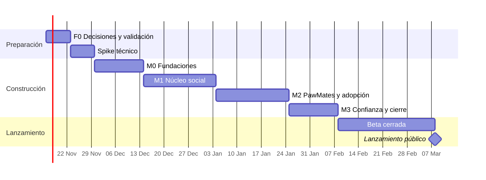

# Plan de construcción — PawBook MVP

| Campo | Valor |
|---|---|
| Versión | 1.1 |
| Fecha | 2026-11-13 |
| Alcance | Desde las decisiones previas hasta el lanzamiento público del MVP (Fase 1) |
| Equipo supuesto | 2 desarrolladores full-stack + socios (producto, legal, operaciones) |
| Duración estimada | ~16 semanas: 1 de decisiones, 1 de spike, 10 de construcción y 4 de beta |
| Documentos base | [PRD](01-PRD.md) · [SRS](02-SRS.md) · [Arquitectura](03-arquitectura.md) · [Diseño](diseno/index.html) |

## Cómo usar este plan

- Marca `[x]` cada tarea al terminarla. Una tarea está terminada solo si cumple la [Definición de terminado](#definición-de-terminado).
- Cada tarea lleva un identificador `T-<hito>.<n>` para referenciarla en ramas, PR e issues (por ejemplo, la rama `feat/T-M1.07-reacciones`).
- Entre corchetes van los requisitos que cubre (`FR-*`, `NFR-*`) o la sección de arquitectura (`§`).
- Repositorio: **[api]** `pawbook-api`, **[web]** `pawbook-web`, **[docs]** `pawbook-docs`, **[ops]** infraestructura y cuentas, **[socios]** decisiones de negocio, **[diseño]** pantallas nuevas en `docs/diseno/` (claro y oscuro) antes de construirlas.
- Ningún hito empieza sin superar la **puerta de salida** del anterior.

## Punto de partida

- **Diseño.** [`docs/diseno/`](diseno/index.html) tiene 18 pantallas en tema claro y oscuro: feed, perfil, PawMates, adopción y chat (móvil); feed, adopción, mensajes y registro (desktop); onboarding en 3 pasos; y los estados de carga, vacío, error, servicio degradado y PawMates desactivado. Cada pantalla tiene al menos una tarea web en este plan.
- **Pantallas sin diseño todavía.** Login, recuperación de contraseña, verificación de correo, notificaciones, búsqueda, hashtag, detalle de publicación, crear publicación en móvil, pantalla de match, ajustes y paneles de organización y moderación. Se diseñan en las tareas `[diseño]` de su hito, antes de la tarea web que las construye.
- **Prototipo `pawbook-web`.** Ya existe un Next.js con las rutas de registro, mascota, seguir, feed, PawMates, adopción, mensajes y perfil, con datos de ejemplo (`src/lib/sample-data.ts`), sistema de diseño, conmutador de tema y tests unitarios. Las tareas web de este plan lo **evolucionan**: sustituyen los datos de ejemplo por la API y Stream, no reescriben las vistas.

## Calendario

Las fechas son orientativas; se recalculan al cerrar cada puerta de salida.

---

## F0 — Decisiones y validación (semana 1)

**Objetivo:** cerrar las preguntas que cambian requisitos y confirmar que el problema existe.

### Decisiones de los socios
- [ ] T-F0.01 [socios] Elegir mercado inicial: España o Colombia (PRD Q1). Fija idioma, moneda, ley de datos y región de la nube.
- [ ] T-F0.02 [socios] Fijar la edad mínima de registro (PRD Q2) [FR-AUTH-001]. Sustituye el marcador `[EDAD MÍNIMA]` del diseño.
- [ ] T-F0.03 [socios] Decidir si una mascota puede tener co-propietarios (PRD Q5) [FR-PET-007].
- [ ] T-F0.04 [socios] Definir el presupuesto mensual de infraestructura y el tope para GetStream (PRD Q4).
- [ ] T-F0.05 [socios] Elegir la tecnología de la app móvil de la Fase 2 (Expo, Flutter o nativa). Afecta cómo se consume el contrato (§7.2).
- [ ] T-F0.06 [socios] Elegir la ciudad de la beta cerrada.

### Validación del problema
- [ ] T-F0.07 [socios] Preparar el guion de entrevistas (técnica Mom Test) para dueños y refugios.
- [ ] T-F0.08 [socios] Entrevistar a 15 dueños de perros o gatos.
- [ ] T-F0.09 [socios] Entrevistar a 5 refugios o fundaciones; identificar 3 dispuestos a participar en la beta.
- [ ] T-F0.10 [socios] Resumir los hallazgos y confirmar o descartar las hipótesis H1-H3 del PRD.

### Legal y cuentas
- [ ] T-F0.11 [socios] Contratar asesoría legal para términos, privacidad, cookies y normas de comunidad [OR-LEG-001].
- [ ] T-F0.12 [ops] Crear la organización de GitHub y activar autenticación de dos factores obligatoria.
- [ ] T-F0.13 [ops] Crear la cuenta de GetStream y solicitar el plan para startups.
- [ ] T-F0.14 [ops] Crear el proyecto de Google Cloud con la API de Gemini y alertas de presupuesto.
- [ ] T-F0.15 [ops] Registrar el dominio y configurar el correo del equipo.

### Puerta de salida F0
- [ ] Q1, Q2, Q4 y Q5 respondidas y reflejadas en el PRD y el SRS.
- [ ] Hallazgos de entrevistas documentados en `pawbook-docs`.
- [ ] Al menos 3 refugios comprometidos con la beta.

---

## Spike técnico (semana 2)

**Objetivo:** reducir la incertidumbre de GetStream y del stack antes de escribir código de producción (§13 de la arquitectura). El código del spike se descarta.

- [ ] T-SP.01 [api] Crear las apps de GetStream `pawbook-dev`, `pawbook-staging` y `pawbook-prod`.
- [ ] T-SP.02 [api] Probar con `@stream-io/node-sdk` los grupos de feed `pet`, `timeline`, `notification` y `foryou` (§3.2).
- [ ] T-SP.03 [api] Verificar que las reacciones son únicas por usuario de Stream (ADR-002) y que se pueden reemplazar.
- [ ] T-SP.04 [api] Verificar las notificaciones agregadas ("Luna y 12 más") [FR-NOT-002].
- [ ] T-SP.05 [api] Configurar los permisos de Stream: Feeds solo lectura para clientes (§3.3, NFR-SEC-006).
- [ ] T-SP.06 [api] Crear un canal de chat desde el servidor y conectar dos usuarios desde un cliente de prueba.
- [ ] T-SP.07 [api] Probar GetStream Moderation con 50 textos en español y 50 fotos de mascotas; medir los falsos positivos.
- [ ] T-SP.08 [api] Decidir la implementación del feed "Para ti": selectores o ranking de Stream frente a un job propio.
- [ ] T-SP.09 [api] Verificar la firma de webhooks de Stream con Hono.
- [ ] T-SP.10 [api] Arrancar Hono + Drizzle + Better Auth en Bun y ejecutar el mismo build en Node 22 (CON-TECH-002).
- [ ] T-SP.11 [web] Probar el SDK React de Feeds y `stream-chat-react` en Next.js; medir el impacto en el bundle (NFR-PERF-005).
- [ ] T-SP.12 [socios] Estimar el coste mensual de GetStream con 10.000 usuarios y 13.000 mascotas.

### Puerta de salida del spike
- [ ] ADR-002 confirmada o modificada en `pawbook-docs`.
- [ ] Coste de GetStream dentro del presupuesto de T-F0.04.
- [ ] Decisión documentada sobre el feed "Para ti".
- [ ] Sin bloqueos técnicos abiertos en Bun.

---

## M0 — Fundaciones (semanas 3-4)

**Objetivo:** un usuario crea su cuenta y su mascota en staging, y la web se conecta a GetStream.

### Repositorios y herramientas
- [ ] T-M0.01 [docs] Crear `pawbook-docs` y mover allí PRD, SRS, arquitectura, este plan y los ADR.
- [ ] T-M0.02 [api] Crear `pawbook-api` con TypeScript `strict`, Biome, `bun test` y la estructura de §7.1.
- [ ] T-M0.03 [web] Adoptar el prototipo `pawbook-web` como repositorio oficial: revisar Next.js, TypeScript `strict`, Biome y Tailwind 4, y marcar `sample-data.ts` como temporal.
- [ ] T-M0.04 [ops] Crear un repositorio plantilla con la configuración común (tsconfig, Biome, workflows de CI).
- [ ] T-M0.05 [ops] Proteger la rama `main` en todos los repos: PR obligatorio, 1 aprobación, CI en verde.
- [ ] T-M0.06 [ops] Configurar Renovate o Dependabot en todos los repos.
- [ ] T-M0.07 [ops] Configurar GitHub Packages y el `bunfig.toml` con el scope `@pawbook` (§7.2).

### Integración continua
- [ ] T-M0.08 [api] CI con formato, lint, tipos, tests, build e imagen OCI [NFR-MAINT-003].
- [ ] T-M0.09 [api] Añadir `dependency-cruiser` con las reglas de fronteras entre módulos [NFR-MAINT-002].
- [ ] T-M0.10 [api] Generar `openapi.json` en el build y verificar compatibilidad con `oasdiff` [CON-DES-004].
- [ ] T-M0.11 [api] Publicar `@pawbook/contracts` y el `openapi.json` al crear un tag semver.
- [ ] T-M0.12 [web] CI con formato, lint, tipos, tests y build.

### Infraestructura
- [ ] T-M0.13 [api] `docker-compose` local con Postgres 16 + PostGIS, Valkey y MinIO.
- [ ] T-M0.14 [ops] Aprovisionar staging: contenedores, Postgres gestionado con PostGIS, Valkey, almacenamiento S3 y CDN.
- [ ] T-M0.15 [ops] Configurar el gestor de secretos y cargar las credenciales de staging [NFR-SEC-007].
- [ ] T-M0.16 [ops] Despliegue automático a staging al mergear en `main`.
- [ ] T-M0.17 [ops] Configurar Sentry, logs estructurados y trazas OpenTelemetry en staging [NFR-OBS-001].

### Base de la API
- [ ] T-M0.18 [api] Kernel compartido: UUIDv7, errores RFC 9457, `Result`, reloj inyectable [COM-003, OR-DB-002].
- [ ] T-M0.19 [api] App Hono con middlewares: `requestId`, logger, CORS, cabeceras de seguridad, manejo de errores [NFR-SEC-008].
- [ ] T-M0.20 [api] Rate limiting con Valkey por IP y por usuario [NFR-SEC-004].
- [ ] T-M0.21 [api] Paginación por cursor reutilizable [COM-004].
- [ ] T-M0.22 [api] Soporte de `Idempotency-Key` [NFR-REL-001].
- [ ] T-M0.23 [api] Tabla outbox + worker con pg-boss + tabla inbox (§8).
- [ ] T-M0.24 [api] `GET /v1/health`, `GET /v1/ready` y `GET /v1/openapi.json`.

### Módulo `identity`
- [ ] T-M0.25 [api] Registro con correo, contraseña y fecha de nacimiento [FR-AUTH-001].
- [ ] T-M0.26 [api] Verificación de correo y proveedor de correo transaccional [FR-AUTH-002].
- [ ] T-M0.27 [api] Login con Google (OIDC) [FR-AUTH-003].
- [ ] T-M0.28 [api] Access token de 15 min y refresh rotatorio con detección de reutilización [FR-AUTH-004].
- [ ] T-M0.29 [api] Recuperación de contraseña con respuesta uniforme [FR-AUTH-005].
- [ ] T-M0.30 [api] Bloqueo de acciones sociales sin correo verificado [FR-AUTH-006].
- [ ] T-M0.31 [api] Registrar la aceptación de términos con versión y fecha [OR-LEG-001].

### Módulo `pets`
- [ ] T-M0.32 [api] Crear, editar y archivar mascotas, con un máximo de 10 por usuario [FR-PET-001, 004, 006].
- [ ] T-M0.33 [api] `@handle` único con cambio limitado a uno cada 30 días [FR-PET-002].
- [ ] T-M0.34 [api] Middleware `activePet` con cabecera `X-Pet-Id` y caché de propiedad [FR-PET-005].
- [ ] T-M0.35 [api] Sincronizar la mascota con su usuario de Stream (`pet_<id>`) al crearla o editarla.

### Tokens de Stream
- [ ] T-M0.36 [api] `POST /v1/stream/token` con token de Feeds por mascota y de Chat por usuario [FR-AUTH-010].

### Base de la web
- [ ] T-M0.37 [web] Portar los tokens de diseño del demo: colores, tipografías, radios, sombras.
- [ ] T-M0.38 [web] Layout de 3 columnas con barra lateral y navegación inferior en móvil [UI-002].
- [ ] T-M0.39 [web] Cliente de API desde `@pawbook/contracts`, TanStack Query y renovación de tokens.
- [ ] T-M0.40 [web] Pantallas de registro, login, Google, verificación y recuperación de contraseña.
- [ ] T-M0.41 [web] Onboarding paso 2: crear la primera mascota con `@handle` y comprobación de disponibilidad (Onb-Mascota).
- [ ] T-M0.42 [web] Selector de mascota activa (Zustand) y reconexión a Stream al cambiarla [UI-003].
- [ ] T-M0.43 [web] Estados de carga, vacío y error reutilizables [UI-004].
- [ ] T-M0.44 [web] Configurar `next-intl` con catálogo en español [OR-I18N-001].
- [ ] T-M0.45 [web] Tema claro y oscuro: tokens de ambos temas, conmutador, preferencia del sistema por defecto, persistencia y aplicación antes del primer pintado [UI-006].
- [ ] T-M0.46 [web] PWA instalable: manifiesto, iconos, `service worker` con la carcasa y página sin conexión [UI-007].
- [ ] T-M0.47 [web] Formato regional de fechas, números y tiempos relativos ("hace 2 h") [OR-I18N-002].
- [ ] T-M0.48 [api] Mostrar u ocultar el nombre de pila del responsable en el perfil de la mascota [FR-PET-008].

### Diseño M0
- [ ] T-M0.49 [diseño] Añadir el campo de fecha de nacimiento a Onb-Registro y Desktop-Registro, manteniendo la casilla de aceptación de términos [FR-AUTH-001].
- [ ] T-M0.50 [diseño] Diseñar login, recuperación de contraseña y resultado de la verificación de correo (enlace válido y caducado) [FR-AUTH-002, 005].

### Puerta de salida M0
- [ ] En staging, un usuario nuevo se registra, verifica su correo, crea una mascota y la web se conecta a Stream.
- [ ] `@pawbook/contracts` 0.x publicado y consumido por la web.
- [ ] CI en verde en ambos repos con todas las verificaciones activas.

---

## M1 — Núcleo social (semanas 5-7)

**Objetivo:** publicar, reaccionar, comentar, seguir y recibir notificaciones en tiempo real.

### Módulo `media`
- [ ] T-M1.01 [api] `POST /v1/media/uploads` con URL prefirmada que fija tipo y tamaño [SW-005].
- [ ] T-M1.02 [api] Job de procesado con sharp: quitar EXIF y generar variantes de 320, 640 y 1.080 px [FR-FEED-002].
- [ ] T-M1.03 [api] Moderación automática de la imagen antes de marcarla como lista [FR-MOD-005].
- [ ] T-M1.04 [api] Limpiar los medios huérfanos tras 24 h.

### Módulo `social`: publicaciones
- [ ] T-M1.05 [api] Puerto `SocialFeedPort` con adaptador en memoria para tests y adaptador de Stream (§3.4).
- [ ] T-M1.06 [api] Crear publicaciones con texto, hasta 10 imágenes, estado de ánimo y ubicación [FR-FEED-001, 003, 004].
- [ ] T-M1.07 [api] Moderación del texto antes de publicar [FR-MOD-005].
- [ ] T-M1.08 [api] Editar (con marca "editado") y eliminar publicaciones [FR-FEED-005].
- [ ] T-M1.09 [api] Extraer hashtags y menciones; las menciones notifican [FR-FEED-009].

### Módulo `social`: interacciones
- [ ] T-M1.10 [api] Reacciones `paw`, `heart`, `bone` y `fish`: una por mascota, reemplazable [FR-FEED-006].
- [ ] T-M1.11 [api] Comentarios con un nivel de respuestas y reglas de borrado [FR-FEED-007].
- [ ] T-M1.12 [api] Guardar y quitar publicaciones guardadas [FR-FEED-008].
- [ ] T-M1.13 [api] Seguir y dejar de seguir; listas de seguidores y seguidos [FR-SOC-001].
- [ ] T-M1.14 [api] Feed "Para ti" según la decisión del spike [FR-SOC-003].
- [ ] T-M1.15 [api] Sugerencias de mascotas por especie y ciudad [FR-SOC-004].
- [ ] T-M1.16 [api] Endpoint de webhooks de Stream con verificación de firma e inbox [SW-003].

### Búsqueda
- [ ] T-M1.17 [api] Índice `pg_trgm` + `unaccent` y `GET /v1/search/pets` [FR-SRCH-001].
- [ ] T-M1.18 [api] `GET /v1/hashtags/{tag}` [FR-SRCH-002].

### Web
- [ ] T-M1.19 [web] Feed "Siguiendo" y "Para ti" con scroll infinito y actualizaciones en tiempo real [FR-SOC-002].
- [ ] T-M1.20 [web] `PostCard` portado del demo y dividido en componentes de ≤ 250 líneas.
- [ ] T-M1.21 [web] Crear publicación: subida directa, progreso, recorte y vista previa.
- [ ] T-M1.22 [web] Reacciones con actualización optimista y animación del demo.
- [ ] T-M1.23 [web] Comentarios y respuestas.
- [ ] T-M1.24 [web] Perfil de mascota con publicaciones, seguidores y botón de seguir [FR-PET-003].
- [ ] T-M1.25 [web] Centro de notificaciones con contador de no leídas en tiempo real [FR-NOT-001, 003].
- [ ] T-M1.26 [web] Búsqueda y página de hashtag.
- [ ] T-M1.27 [web] Colección de guardados.
- [ ] T-M1.28 [web] Páginas públicas `/@handle` y `/p/{id}` renderizadas en servidor con Open Graph [FR-FEED-010, UI-005].
- [ ] T-M1.29 [api] Seguir y dejar de seguir organizaciones con el grupo de feed `org` (§3.2) [FR-SOC-005].
- [ ] T-M1.30 [api] `GET /v1/suggestions/organizations` y sugerencias reutilizables en el feed, excluyendo seguidas y bloqueadas [FR-SOC-004].
- [ ] T-M1.31 [web] Onboarding paso 3 (Onb-Seguir): pestañas Gatos, Perros y Refugios, contador "N de 5", "Omitir por ahora" y aviso de verificar correo con "Reenviar" [FR-SOC-004, FR-AUTH-002].
- [ ] T-M1.32 [web] Columna lateral del feed en ≥ 1.280 px con sugerencias; los bloques de PawMates y adopción se activan en T-M2.25 [UI-008].
- [ ] T-M1.33 [web] Aviso de servicio degradado (Est-Error) cuando Stream no responde, manteniendo perfiles, adopción y búsqueda [NFR-AVA-002].

### Diseño M1
- [ ] T-M1.34 [diseño] Diseñar notificaciones, búsqueda, hashtag, detalle de publicación `/p/{id}`, crear publicación en móvil e hilo de comentarios en móvil.

### Puerta de salida M1
- [ ] Prueba E2E: A publica, B (seguidor) lo ve en ≤ 5 s, reacciona y comenta, y A recibe la notificación [NFR-PERF-002].
- [ ] Una publicación compartida por URL se ve sin sesión y muestra vista previa en mensajería.
- [ ] `@pawbook/contracts` 1.0.0 publicado.

---

## M2 — PawMates y adopción (semanas 8-10)

**Objetivo:** dos dueños reales chatean tras un match, y un refugio recibe una solicitud de adopción.

### Módulo `pawmates`
- [ ] T-M2.01 [api] Perfil de juego: tamaño, energía, actividad y radio de 1 a 25 km [FR-PM-001].
- [ ] T-M2.02 [api] Guardar la ubicación reducida a una celda de ~1 km con PostGIS [FR-PM-002].
- [ ] T-M2.03 [api] Candidatos por distancia y compatibilidad, excluyendo bloqueados y ya evaluados [FR-PM-003].
- [ ] T-M2.04 [api] Swipes y creación de match con outbox en la misma transacción [FR-PM-004].
- [ ] T-M2.05 [api] Puerto `ChatPort` y adaptador de Stream Chat (§3.4).
- [ ] T-M2.06 [api] Al hacer match, crear el canal 1:1 y notificar a ambos [FR-PM-005].
- [ ] T-M2.07 [api] Deshacer un match y archivar el canal [FR-PM-007].
- [ ] T-M2.08 [api] Configurar en Stream la moderación del chat, los adjuntos de imagen, las confirmaciones de entrega y lectura y la presencia [FR-PM-006].

### Módulos `organizations` y `adoption`
- [ ] T-M2.09 [api] Solicitud de organización con documento acreditativo [FR-ORG-001].
- [ ] T-M2.10 [api] Aprobación y rechazo por un administrador, con insignia "Verificada" [FR-ORG-002].
- [ ] T-M2.11 [api] Invitar gestores a la organización [FR-ORG-003].
- [ ] T-M2.12 [api] Fichas de adopción con máquina de estados [FR-ADO-001, 002].
- [ ] T-M2.13 [api] Listado con filtros por especie, ciudad, edad y urgencia [FR-ADO-003].
- [ ] T-M2.14 [api] Solicitud de adopción con cuestionario, canal de chat y correo a los gestores [FR-ADO-004].

### Web
- [ ] T-M2.15 [web] Activación de PawMates con explicación previa al permiso de ubicación [HW-002].
- [ ] T-M2.16 [web] Descubrimiento de candidatos con distancias redondeadas y nunca exactas.
- [ ] T-M2.17 [web] Pantalla de match y lista de matches.
- [ ] T-M2.18 [web] Bandeja de mensajes y conversación con `stream-chat-react` y el tema de PawBook.
- [ ] T-M2.19 [web] Listado y ficha de adopción con renderizado en servidor.
- [ ] T-M2.20 [web] Formulario de solicitud de adopción.
- [ ] T-M2.21 [web] Panel de organización: solicitud de verificación, gestores, fichas y solicitudes recibidas.
- [ ] T-M2.22 [api] Desactivar PawMates: retirar de candidatos y borrar la ubicación, conservando matches [FR-PM-008].
- [ ] T-M2.23 [api] Temperamento en el perfil de juego y etiqueta de compatibilidad calculada en servidor [FR-PM-001, FR-PM-009].
- [ ] T-M2.24 [api] Publicar la actividad "Nuevo en adopción" en el feed `org` al crear una ficha o marcarla urgente, y reflejar el estado final [FR-ADO-005].
- [ ] T-M2.25 [web] Tarjeta "Nuevo en adopción" en el feed y bloques "PawMates cerca" y "En adopción" de la columna lateral [FR-ADO-005, UI-008].
- [ ] T-M2.26 [web] Desactivar PawMates y editar el perfil de juego desde la pantalla de PawMates [FR-PM-008].

### Diseño M2
- [ ] T-M2.27 [diseño] Diseñar la pantalla de match, el panel de organización y la ficha en estado adoptada; añadir actividad favorita y temperamento a Est-PawMatesOff [FR-PM-001].

### Puerta de salida M2
- [ ] Prueba E2E: dos usuarios hacen match y se envían mensajes en ≤ 1 s [NFR-PERF-003].
- [ ] Prueba de privacidad: ninguna respuesta de la API ni de Stream contiene coordenadas exactas.
- [ ] Prueba E2E: refugio verificado publica una ficha y recibe una solicitud por chat y correo.

---

## M3 — Confianza y cierre (semanas 11-12)

**Objetivo:** la plataforma es segura, moderable y cumple la ley antes de abrirla a usuarios reales.

### Moderación
- [ ] T-M3.01 [api] Denuncias sobre publicaciones, comentarios, mensajes, mascotas y organizaciones [FR-MOD-001].
- [ ] T-M3.02 [api] Bloqueos mutuos que ocultan contenido y cierran canales [FR-MOD-003].
- [ ] T-M3.03 [api] Cola de moderación que une denuncias y marcas automáticas, priorizada por gravedad [FR-MOD-002].
- [ ] T-M3.04 [api] Acciones de moderador (ocultar, eliminar, advertir, suspender, expulsar) con log de auditoría inmutable [FR-MOD-004].
- [ ] T-M3.05 [web] Menú de denunciar y bloquear en publicaciones, comentarios, perfiles y chat.
- [ ] T-M3.06 [web] Panel interno de moderación y verificación de organizaciones.

### Cuenta y privacidad
- [ ] T-M3.07 [api] Eliminación de cuenta en PostgreSQL, almacenamiento y Stream en ≤ 30 días [FR-AUTH-008].
- [ ] T-M3.08 [api] Exportación de datos en JSON [FR-AUTH-009].
- [ ] T-M3.09 [api] Listar y cerrar sesiones [FR-AUTH-007].
- [ ] T-M3.10 [web] Pantallas de ajustes de cuenta, sesiones, exportación y eliminación.
- [ ] T-M3.11 [web] Publicar términos, privacidad, cookies y normas de comunidad; banner de cookies con rechazo por defecto [OR-LEG-001].

### IA
- [ ] T-M3.12 [api] Puerto `AiProvider` con adaptador de Gemini y modelo configurable [SW-004].
- [ ] T-M3.13 [api] `POST /v1/ai/captions` con entrada delimitada, salida validada y moderada [FR-AI-001, 003].
- [ ] T-M3.14 [api] Cuota de 20 solicitudes de IA al día por usuario y circuit breaker [FR-AI-002, NFR-REL-002].
- [ ] T-M3.15 [web] Botón "Sugerir pie de foto" con etiqueta de contenido generado por IA [CON-REG-002].

### Calidad
- [ ] T-M3.16 [api] Cobertura ≥ 80 % en dominio y casos de uso [NFR-MAINT-001].
- [ ] T-M3.17 [api] Revisión contra la checklist de OWASP ASVS nivel 2 y corrección de hallazgos [NFR-SEC-001].
- [ ] T-M3.18 [api] Timeouts y circuit breakers en todos los proveedores externos [NFR-REL-002].
- [ ] T-M3.19 [web] Auditoría WCAG 2.2 AA con herramientas automáticas y revisión manual con teclado y lector de pantalla [NFR-USA-001].
- [ ] T-M3.20 [web] LCP ≤ 2,5 s en 4G y JavaScript inicial ≤ 250 KB [NFR-PERF-004, 005].

### Producción
- [ ] T-M3.21 [ops] Aprovisionar producción en la región del mercado elegido, con la misma configuración que staging.
- [ ] T-M3.22 [ops] Backups con PITR y un ensayo de restauración documentado [NFR-REL-003].
- [ ] T-M3.23 [ops] Alertas de errores 5xx > 1 %, p95 > 500 ms y fallos de webhooks [NFR-OBS-003].
- [ ] T-M3.24 [ops] Runbook de incidentes: caída de Stream, de Gemini y de la base de datos.

### Apelaciones, ayuda y diseño M3
- [ ] T-M3.25 [api] `POST /v1/moderation/appeals`: una revisión por contenido bloqueado, a la cola de moderación, con notificación del resultado [FR-MOD-006].
- [ ] T-M3.26 [web] Botón "Pedir revisión" en el error de moderación del catálogo de estados, conservando el texto [FR-MOD-006].
- [ ] T-M3.27 [web] Página de ayuda enlazada desde el pie y los ajustes [UI-009].
- [ ] T-M3.28 [diseño] Diseñar ajustes de cuenta, sesiones, exportación, eliminación, panel de moderación y verificación de organizaciones.

### Puerta de salida M3
- [ ] Checklist de seguridad aprobada sin hallazgos críticos ni altos abiertos.
- [ ] Revisión legal de textos y flujos de datos aprobada.
- [ ] Prueba de borrado: una cuenta eliminada no deja datos en Stream ni en el almacenamiento.
- [ ] Restauración de backup probada.

---

## Beta cerrada (semanas 13-16)

**Objetivo:** medir las métricas del PRD con 200 usuarios reales de una ciudad.

### Preparación
- [ ] T-B.01 [api] Prueba de carga: 200 solicitudes/s con p95 ≤ 300 ms y 1.000 conexiones concurrentes [NFR-PERF-001, 007].
- [ ] T-B.02 [ops] Pentest externo o revisión de seguridad independiente.
- [ ] T-B.03 [web] Analítica de producto respetuosa con la privacidad: eventos de activación, retención, publicaciones, matches y adopciones.
- [ ] T-B.04 [web] Sistema de invitaciones o lista de espera.
- [ ] T-B.05 [socios] Sembrar contenido con los 3+ refugios comprometidos y 10 cuentas creadoras de contenido de mascotas.
- [ ] T-B.06 [socios] Formar al equipo de moderación y definir turnos para responder en < 24 h.

### Durante la beta
- [ ] T-B.07 [socios] Invitar a 200 usuarios en tandas de 50 por semana.
- [ ] T-B.08 [socios] Revisión semanal de métricas: activación, D7, publicaciones por usuario, matches con ≥ 3 mensajes.
- [ ] T-B.09 [socios] Canal de feedback y 5 entrevistas de seguimiento por semana.
- [ ] T-B.10 [api][web] Corregir errores priorizados cada semana.
- [ ] T-B.11 [socios] Prueba de usabilidad con 5 usuarios: registro, mascota y publicación en ≤ 3 min [NFR-USA-002].

### Puerta de salida de la beta (criterios de lanzamiento)
- [ ] Activación ≥ 30 % (registro → mascota → publicación en 24 h).
- [ ] Disponibilidad ≥ 99,5 % durante la beta [NFR-AVA-001].
- [ ] 95 % de las denuncias resueltas en < 24 h.
- [ ] Sin errores críticos abiertos.
- [ ] Coste real de GetStream y Gemini por usuario activo dentro del presupuesto.

---

## Lanzamiento público

- [ ] T-L.01 [web] Abrir el registro y retirar la lista de espera.
- [ ] T-L.02 [socios] Página de aterrizaje y plan de comunicación local.
- [ ] T-L.03 [ops] Escalar réplicas de la API y revisar los límites del plan de GetStream.
- [ ] T-L.04 [socios] Retrospectiva del MVP y priorización de la Fase 2.

---

## Fase 2 y Fase 3 (borrador, se detalla al cerrar la beta)

### Fase 2
- [ ] App móvil con la tecnología elegida en T-F0.05, consumiendo el mismo `/v1` (§11).
- [ ] Notificaciones push y `POST /v1/devices`.
- [ ] Inicio de sesión con Apple.
- [ ] Traductor de sonidos con audio real, etiquetado como entretenimiento.
- [ ] Filtros de foto.
- [ ] Retos, puntos e insignias calculados en servidor.
- [ ] Vídeo corto en publicaciones.
- [ ] PawMates: mapa y quedadas.

### Fase 3 (requiere revisión legal previa)
- [ ] Mercadito con política de artículos prohibidos.
- [ ] Directorio de veterinarios y citas.
- [ ] Telemedicina con profesionales verificados (GetStream Video).
- [ ] Donaciones con pasarela de pagos y KYC de fundaciones.

---

## Definición de terminado

Una tarea se marca `[x]` solo si cumple todo lo que le aplica:

- [ ] El código está mergeado en `main` mediante PR revisado por otra persona.
- [ ] El CI está en verde: formato, lint, tipos, tests, build y, en la API, `dependency-cruiser` y `oasdiff`.
- [ ] Los casos de uso nuevos tienen tests unitarios; los adaptadores, tests de integración.
- [ ] Los endpoints nuevos aparecen en `openapi.json` con ejemplos y errores documentados.
- [ ] Si cambió el contrato, hay una nueva versión de `@pawbook/contracts` publicada.
- [ ] La funcionalidad está desplegada y probada en staging.
- [ ] Las vistas web nuevas tienen estados de carga, vacío y error, funcionan con teclado y coinciden con `docs/diseno/` en tema claro y oscuro.
- [ ] Los textos nuevos están en el catálogo de traducción.
- [ ] Los logs no contienen datos personales ni secretos [NFR-OBS-002].
- [ ] Los requisitos del SRS que cubre están referenciados en el PR.

## Seguimiento

| Hito | Tareas | Estado | Puerta superada |
|---|---:|---|---|
| F0 Decisiones y validación | 15 | Pendiente | ☐ |
| Spike técnico | 12 | Pendiente | ☐ |
| M0 Fundaciones | 50 | Pendiente | ☐ |
| M1 Núcleo social | 34 | Pendiente | ☐ |
| M2 PawMates y adopción | 27 | Pendiente | ☐ |
| M3 Confianza y cierre | 28 | Pendiente | ☐ |
| Beta cerrada | 11 | Pendiente | ☐ |
| Lanzamiento | 4 | Pendiente | ☐ |
